<div align="center">

# Browser-Native Agents with WebMCP and Google ADK

A reference storefront application demonstrating how a Google ADK agent interacts with a live web UI through the W3C Web Model Context Protocol (`navigator.modelContext`) and declarative HTML forms.

<p>
  
</p>

[](https://www.python.org/)
[](https://adk.dev/)
[](#webmcp-surfaces)
[](https://fastapi.tiangolo.com/)
[](#api-and-websocket-reference)
[](https://www.apache.org/licenses/LICENSE-2.0)

<p>
  <a href="#overview">Overview</a> ·
  <a href="#architecture">Architecture</a> ·
  <a href="#webmcp-surfaces">WebMCP Surfaces</a> ·
  <a href="#tools-and-guardrails">Tools &amp; Guardrails</a> ·
  <a href="#quick-start">Quick Start</a> ·
  <a href="#walkthrough">Walkthrough</a> ·
  <a href="#testing-and-evaluation">Testing &amp; Eval</a> ·
  <a href="#deployment-and-observability">Deployment &amp; Metrics</a>
</p>

</div>

---

## Overview

Most browser agents rely on DOM scraping, accessibility-tree heuristics, or screenshot-based coordinate clicking. Small layout changes break selectors, and every UI action requires extra round-trips.

This repository pairs **WebMCP** with **Google ADK** inside a sample e-commerce app (**NexusGear Storefront**). The frontend registers typed JSON-Schema tools directly in the browser tab and forwards tool calls over a WebSocket RPC bridge to an ADK agent (`webmcp_agent`).

| Capability | DOM / Screenshot Automation | WebMCP + Google ADK |
|---|---|---|
| **Tool discovery** | Fragile CSS selectors or ARIA parsing | Explicit JSON Schemas via `navigator.modelContext` / `document.modelContext` and `<form toolname>` |
| **UI execution** | Simulated clicks and keystrokes | Direct RPC calls into live page handlers |
| **Form input** | Per-field focus and typing loops | Single-call declarative HTML form population |
| **Safety checks** | Prompt-only instructions | Deterministic `before_tool_callback` guardrails in Python |
| **Testability** | Slow headless browser runs | Synchronized state store for `pytest` and `agents-cli eval` |

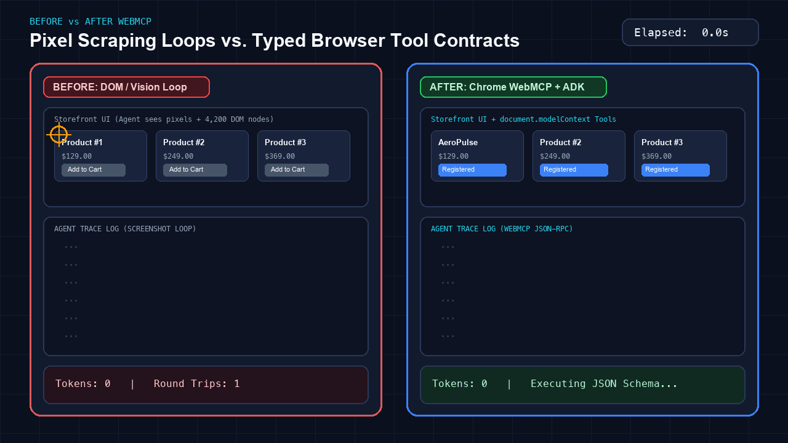

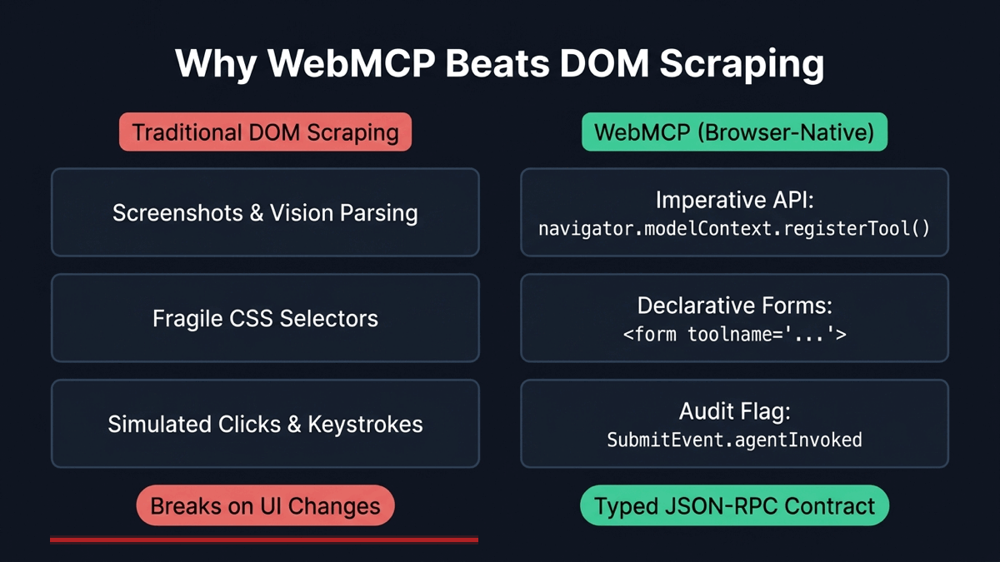

---

## Architecture

A single FastAPI + ADK service (`app/fast_api_app.py`) hosts the storefront UI, WebSocket bridge, ADK runner, and A2A endpoints. A standalone bridge launcher (`app/bridge_server.py`) is also included for external CLI agents.

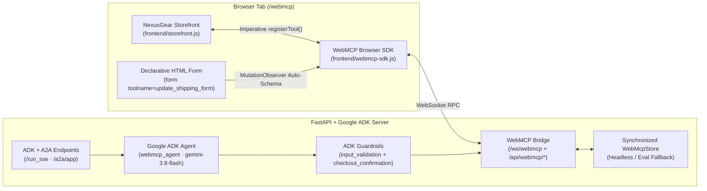

### Checkout Confirmation Flow

Irreversible actions are gated in Python before any RPC call reaches the browser:

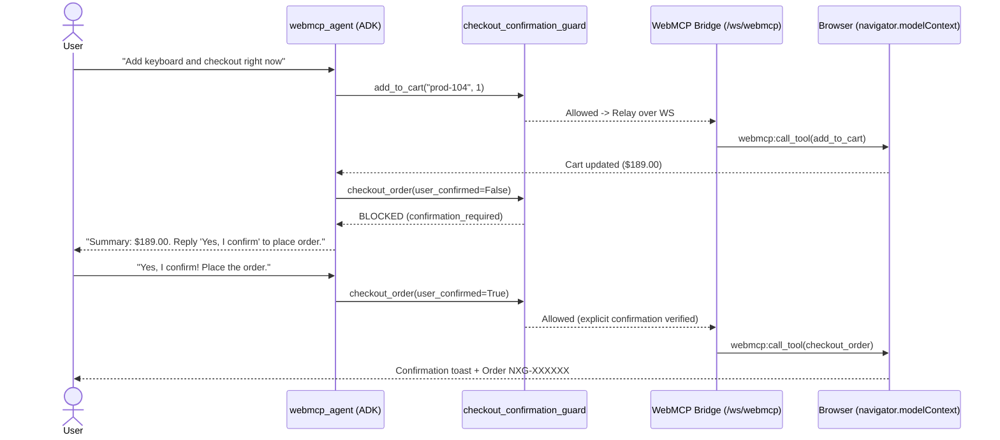

---

## WebMCP Surfaces

[`frontend/webmcp-sdk.js`](frontend/webmcp-sdk.js) adapts both native Chrome WebMCP (`document.modelContext` / `navigator.modelContext`) and the local `window.__webmcpContext` shim for fallback environments, exposing two registration patterns and full Chrome 160+ `Tool` interface compatibility:

- **Chrome 160+ `Tool` compatibility (`readToolAttributes`)**: Safely reads `tool.source ?? tool.window` and nullable `inputSchema`, `outputSchema`, and `annotations` properties without spreading or cloning native browser `Tool` objects.
- **Unified registration lookup**: [`frontend/storefront.js`](frontend/storefront.js) resolves `window.__webmcpContext || window.navigator.modelContext || document.modelContext` to register 7 imperative storefront tools and 1 declarative `<form>` tool (`8` browser tools total, plus `list_webmcp_tools` on the ADK bridge).

### Imperative API (`navigator.modelContext.registerTool`)

[`frontend/storefront.js`](frontend/storefront.js) registers catalog, cart, and checkout handlers with JSON Schemas and DOM updates:

```javascript
window.navigator.modelContext.registerTool({
  name: "search_products",
  description: "Search and filter the NexusGear storefront catalog...",
  inputSchema: {
    type: "object",
    properties: {
      query: { type: "string", description: "Keyword search query" },
      category: { type: "string", description: "audio, peripherals, travel, monitors" },
      max_price: { type: "number", description: "Maximum unit price in USD" },
      in_stock_only: { type: "boolean", description: "Exclude out-of-stock products" }
    }
  },
  execute: async (args, meta) => {
    // Updates filters, highlights matching cards in the DOM, and returns structured JSON
  }
});
```

### Declarative HTML API (`<form toolname="...">`)

A `MutationObserver` in [`frontend/webmcp-sdk.js`](frontend/webmcp-sdk.js) inspects annotated `<form toolname="...">` elements in [`frontend/index.html`](frontend/index.html), derives their JSON Schema from `<input>` and `<select>` attributes, and binds field population without custom tool code:

```html
<form
  id="shippingForm"
  toolname="update_shipping_form"
  tooldescription="Populate the customer's shipping address and delivery speed form."
>
  <input name="full_name" required toolparamdescription="Recipient full name" />
  <input name="email" type="email" required toolparamdescription="Contact email address" />
  <input name="address" required toolparamdescription="Street, city, state, ZIP" />
  <select name="delivery_speed" required toolparamdescription="Shipping speed">
    <option value="standard">Standard ($0.00)</option>
    <option value="express">Express 2-Day ($15.00)</option>
    <option value="overnight">Overnight Air ($29.00)</option>
  </select>
</form>
```

---

## Tools and Guardrails

### ADK Tool Catalog

[`app/agent.py`](app/agent.py) wires 9 typed `FunctionTool` wrappers from [`app/tools.py`](app/tools.py) to the WebMCP bridge:

| Tool | Surface | Behavior | Parameters |
|---|---|---|---|
| `list_webmcp_tools` | Bridge discovery | Read-only | — |
| `search_products` | Imperative | Read-only | `query`, `category`, `max_price`, `in_stock_only` |
| `get_product_details` | Imperative | Read-only | `product_id` |
| `get_cart` | Imperative | Read-only | — |
| `add_to_cart` | Imperative | Mutating | `product_id`, `quantity` (`1–10`) |
| `remove_from_cart` | Imperative | Mutating | `product_id` |
| `apply_promo_code` | Imperative | Mutating | `code` |
| `update_shipping_form` | Declarative (`<form>`) | Mutating | `full_name`, `email`, `address`, `delivery_speed` |
| `checkout_order` | Imperative | Safety-gated | `full_name`, `address`, `user_confirmed` |

<details>
<summary>Sample Storefront Catalog &amp; Promo Codes</summary>

| ID | Product | Category | Price | Stock |
|---|---|---|---|---|
| `prod-101` | AeroPulse Pro ANC Headphones | `audio` | $249.00 | 14 |
| `prod-102` | SonicBuds Lite Wireless Earbuds | `audio` | $129.00 | 28 |
| `prod-103` | StudioMax Planar ANC Headphones | `audio` | $399.00 | 6 |
| `prod-104` | KeyChronos Q1 Mechanical Keyboard | `peripherals` | $189.00 | 19 |
| `prod-105` | PrecisionGlide Pro Ergonomic Mouse | `peripherals` | $89.00 | 32 |
| `prod-106` | NomadPack 35L Tech Carry-On Backpack | `travel` | $219.00 | 0 (Out of Stock) |
| `prod-107` | Voyager Carbon 22-Inch Smart Carry-On | `travel` | $279.00 | 9 |
| `prod-108` | LumaView 16-Inch 4K OLED Portable Monitor | `monitors` | $349.00 | 11 |

Promo codes:
- `WEBMCP20`: 20% off subtotal
- `ADK10`: 10% off subtotal
- `SAVE25`: `$25.00` off orders with subtotal `>= $100.00`

</details>

### Callback Guardrails

[`app/guardrails.py`](app/guardrails.py) registers an ordered callback chain on `root_agent`:

1. `record_turn_context` (`before_agent_callback`): stores `latest_user_message` and `webmcp_session_id` in ADK session state.
2. `input_validation_guard` (`before_tool_callback`): rejects `<script>`, `javascript:`, and inline event handlers (`onerror=`, `onload=`, `onclick=`, `onmouseover=`) in string arguments, and bounds `add_to_cart` quantity to `1–10`.
3. `checkout_confirmation_guard` (`before_tool_callback`): blocks `checkout_order` unless **both** `args["user_confirmed"] is True` and `has_explicit_confirmation(user_text)` matches affirmative approval without negation terms (`"do not"`, `"don't"`, `"never"`, `"cancel"`, `"stop"`, `"abort"`, `"wait"`).

---

## Quick Start

### Prerequisites

- Python `>=3.11, <3.14`
- [`uv`](https://docs.astral.sh/uv/)
- [`google-agents-cli`](https://pypi.org/project/google-agents-cli/) (`uv tool install google-agents-cli`)

### 1. Clone and Install

```bash
git clone https://github.com/sanketbisne/adk-webmcp-storefront.git
cd adk-webmcp-storefront
agents-cli install
```

### 2. Configure Credentials (`.env`)

Use either **Vertex AI (Application Default Credentials)** or a **Google AI Studio API key**:

- **Vertex AI (ADC):**
  ```bash
  gcloud auth application-default login
  ```
  Set `GOOGLE_CLOUD_PROJECT` and `GOOGLE_CLOUD_LOCATION=global` in `.env`.

- **Google AI Studio:**
  Comment out `GOOGLE_*` in `.env` and set:
  ```env
  GEMINI_API_KEY=your-api-key-here
  ```

### 3. Run Locally

```bash
uv run uvicorn app.fast_api_app:app --host 127.0.0.1 --port 8000 --reload
```

Open **[http://127.0.0.1:8000/webmcp](http://127.0.0.1:8000/webmcp)** in Chrome.

Other launch options:
- ADK playground: `agents-cli playground`
- CLI run: `agents-cli run "What WebMCP tools are exposed on this page?"`
- Standalone bridge (`:8765`): `uv run python -m app.bridge_server` (set `WEBMCP_BRIDGE_URL=http://127.0.0.1:8765` for external clients)

---

## Walkthrough

### 1. Search and add to cart
Prompt: `"Search for audio products under $250 and add 1 AeroPulse Pro ANC Headphones to my cart."` — runs `search_products`, `get_cart`, and `add_to_cart` over WebSocket, updating **Cart (1)** (`$249.00 USD`).

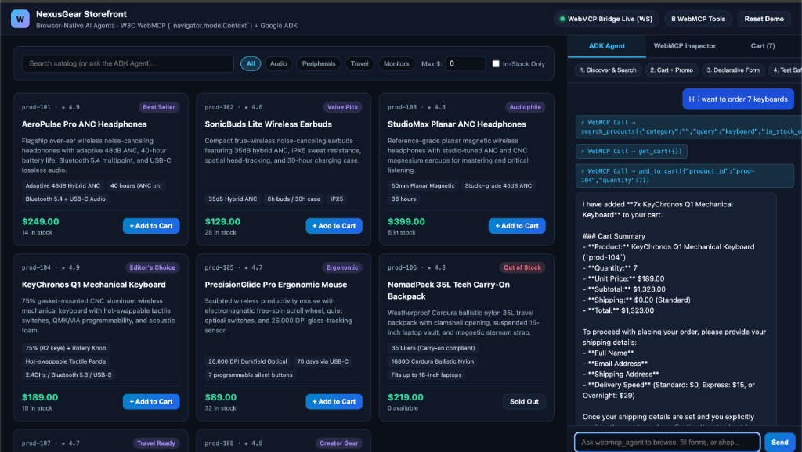

### 2. Declarative HTML form fill (`<form toolname="update_shipping_form">`)
Providing shipping details (`sanket bisne`, `sanketbisne@gmail.com`, `Nagpur`) invokes the declarative form tool directly, highlighting `<form>` and filling all fields.

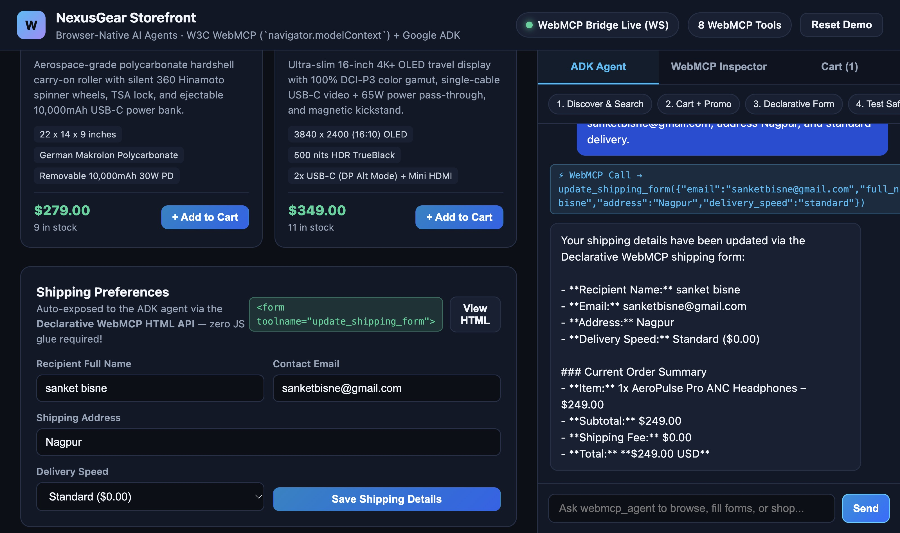

### 3. Checkout confirmation gate (`checkout_confirmation_guard`)
`checkout_confirmation_guard` halts `checkout_order` (`user_confirmed=false`) and asks for explicit approval (`"Yes, I confirm"`).

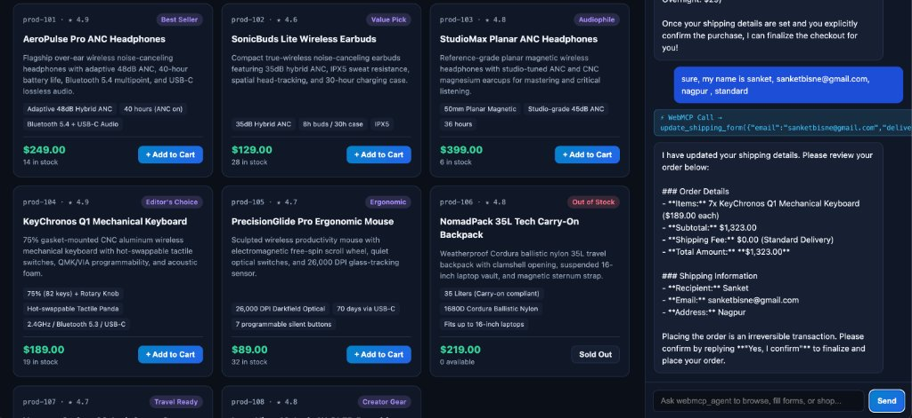

### 4. Confirmed order and receipt
After confirmation, `checkout_order` executes in the browser, resets the cart to `Cart (0)`, and records order `NXG-489625` (`$249.00 USD`).

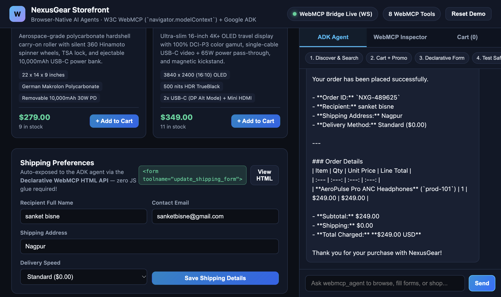

### 5. Completed orders in Cart tab
The **Cart** tab displays the cleared active cart (`Cart (0)`) alongside `Order NXG-489625 Confirmed` under **Completed Orders**.

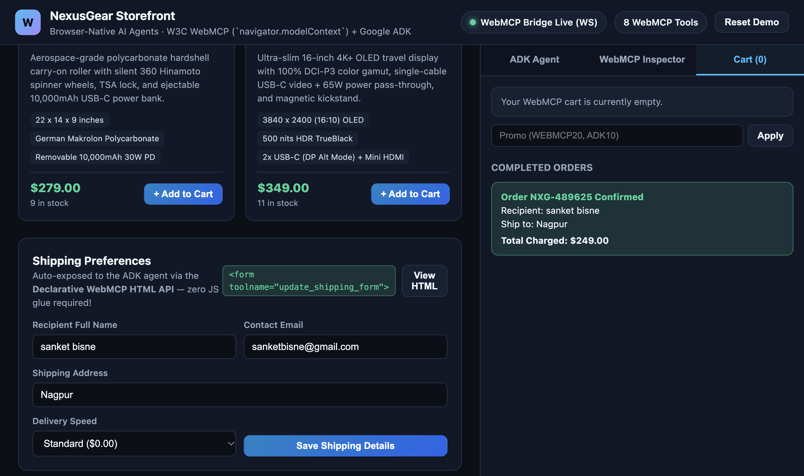

### 6. WebMCP Inspector RPC log
The **WebMCP Inspector** tab logs every `navigator.modelContext` JSON-RPC call and lists active tool schemas.

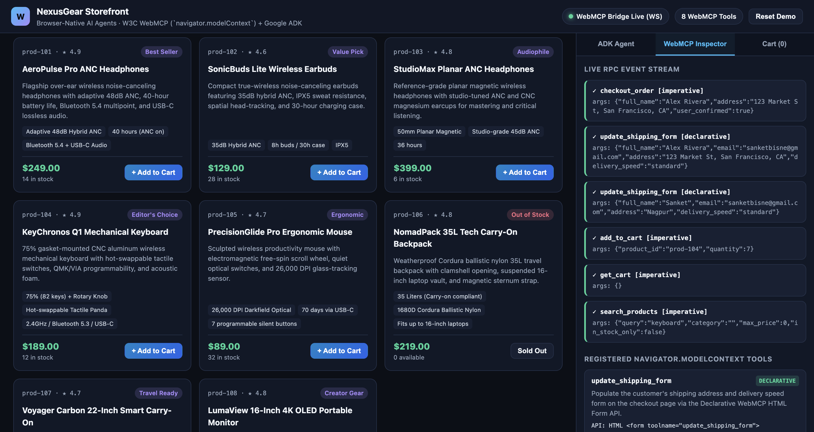

### 7. ADK Dev UI: events and tool graph (`/dev-ui/?app=app`)
Running `"Search for audio products under $250 and add 1 AeroPulse Pro ANC Headphones to my cart."` in ADK Dev UI shows `search_products` and `add_to_cart` events, `$249.00 USD` cart summary, and the tool graph.


### 8. ADK Dev UI: OpenTelemetry trace waterfall
Following up with `"Apply promo code WEBMCP20 and show my cart total."` records spans in the **Trace** tab (`invoke_workflow webmcp_agent`, `generate_content`, `search_products`, `add_to_cart`, `apply_promo_code`).

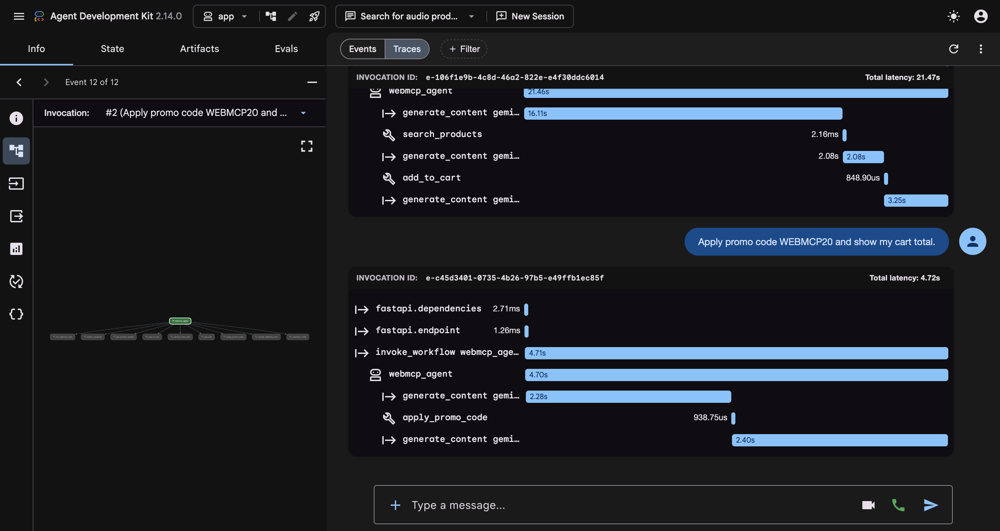

### 9. Out-of-stock fallback
Requesting `prod-106` (`0` in stock) triggers `get_product_details` and `search_products(category="travel", in_stock_only=true)`, recommending `Voyager Carbon 22-Inch Smart Carry-On` (`prod-107`, `$279.00`).

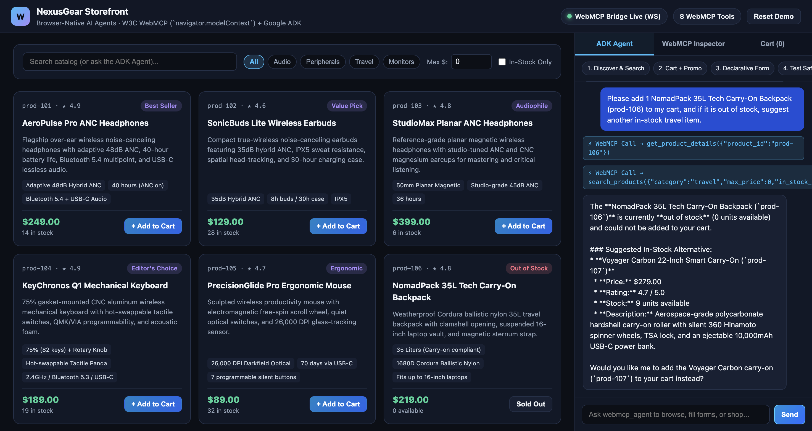

### 10. Multi-item cart, promo, and removal
Adding `prod-105` + `prod-104`, applying `SAVE25` (`-$25.00`), and removing `prod-105` updates the badge to `Cart (1)` with a `$164.00 USD` total.

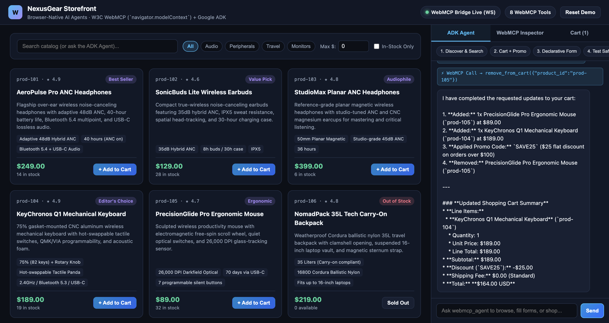

### 11. Input validation guardrail (XSS check)
Sending `<script>alert(1)</script>` in `full_name` is blocked by `input_validation_guard` before touching the DOM.


---

## API and WebSocket Reference

| Endpoint | Method | Description |
|---|---|---|
| `/webmcp` | `GET` | NexusGear Storefront, ADK Copilot panel, and WebMCP Inspector |
| `/ws/webmcp` | `WS` | WebSocket RPC channel relaying `webmcp:register_tools` and `webmcp:call_tool` |
| `/api/webmcp/status` | `GET` | Connected browser tab count and registered imperative/declarative tool names |
| `/api/webmcp/tools` | `GET` | JSON Schemas of active `navigator.modelContext` tools |
| `/api/webmcp/state` | `GET` | Catalog, cart totals, shipping form state, and RPC activity log |
| `/api/webmcp/call` | `POST` | Invoke a WebMCP tool over the bridge (`{tool_name, args, session_id}`) |
| `/api/webmcp/reset` | `POST` | Reset storefront catalog stock, cart, shipping form, and orders |
| `/run_sse` | `POST` | ADK Server-Sent Events streaming endpoint |
| `/a2a/app/.well-known/agent-card.json` | `GET` | A2A AgentCard discovery endpoint |

---

## Project Layout

```text
adk-webmcp-storefront/
├── app/
│   ├── agent.py              # root_agent ("webmcp_agent") and App(name="app")
│   ├── tools.py              # 9 typed ADK FunctionTools for WebMCP
│   ├── guardrails.py         # before_agent and before_tool validation & confirmation gates
│   ├── webmcp_bridge.py      # FastAPI + WebSocket relay (/ws/webmcp, /webmcp, /api/webmcp/*)
│   ├── webmcp_store.py       # Catalog, cart, promo, and shipping state store
│   ├── bridge_server.py      # Standalone WebMCP bridge server (port 8765)
│   ├── fast_api_app.py       # Unified FastAPI server (ADK + A2A + WebMCP Storefront)
│   └── app_utils/            # Telemetry and A2A routing helpers
├── frontend/
│   ├── webmcp-sdk.js         # navigator.modelContext polyfill + <form toolname> scanner
│   ├── storefront.js         # Imperative tool registrations, UI highlights, ADK chat client
│   ├── index.html            # Storefront, WebMCP Inspector, and ADK Copilot UI
│   └── styles.css            # Workspace styles and actuation highlights
├── docs/
│   ├── medium-blog-draft.md  # Full walkthrough & Agent Runtime write-up
│   └── assets/
│       ├── webmcp-adk-banner.jpg         # Architecture banner
│       ├── before-vs-after-webmcp.gif    # Animated Before vs. After WebMCP comparison
│       ├── *.gif                         # DOM-vs-WebMCP and agents-cli pipeline diagrams
│       ├── ui-step*.png / .jpg           # Storefront, Inspector, and ADK Dev UI screenshots
│       └── gcp-*.png / .jpg              # Google Cloud Agent Runtime metrics and log screenshots
├── tests/
│   ├── unit/test_webmcp.py   # Store, guardrail, HTTP, and WebSocket RPC tests
│   ├── integration/          # ADK streaming and A2A server integration tests
│   └── eval/                 # Evaluation config, LLM judge, basic and holdout datasets
├── agents-cli-manifest.yaml
├── pyproject.toml
├── Dockerfile
└── .env.example
```

---

## Testing and Evaluation

### Unit, Integration, and Lint Checks

```bash
# Unit tests (store logic, guardrails, HTTP, WebSocket RPC)
uv run pytest tests/unit -v

# Integration tests (ADK streaming and A2A endpoints)
uv run --env-file .env pytest tests/integration -v

# Frontend syntax check
node --check frontend/webmcp-sdk.js && node --check frontend/storefront.js

# Linting, type checks, and spellcheck (ruff, ty, codespell)
agents-cli lint
```

### Agent Evaluation (`agents-cli eval`)

With Gemini credentials configured in `.env`:

```bash
# Core 4-case suite (discovery, cart+promo, safety block, confirmed checkout)
agents-cli eval run

# Held-out edge cases (out-of-stock fallback and declarative HTML form fill)
agents-cli eval run --dataset tests/eval/datasets/holdout-dataset.json
```

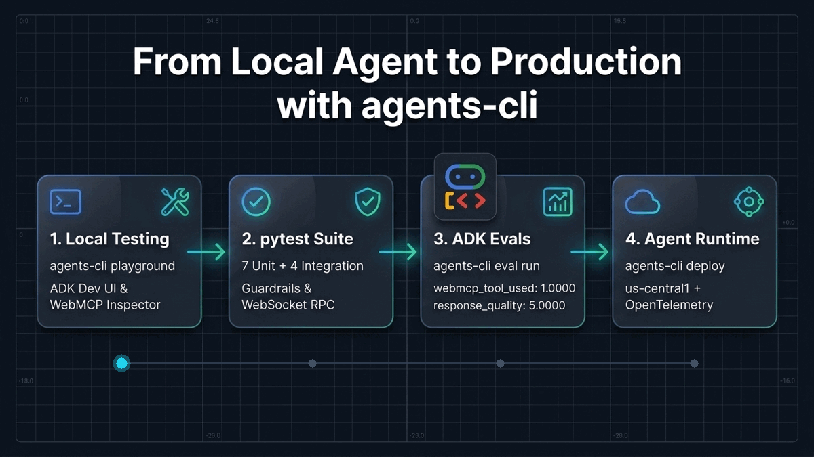

---

## Deployment and Observability

Tested and benchmarked on **Google Cloud Agent Runtime** (`us-west1`, `google-adk`, OpenTelemetry enabled; ephemeral test deployment was subsequently torn down via `agents-cli deploy` cleanup—redeploy anytime with `agents-cli deploy`).

### Observed Results

| Source | Metric | Result |
|---|---|---|
| `tests/unit` | Store, guardrails, WS RPC | `7 passed` |
| `tests/integration` | `test_agent_stream`, `/run_sse`, A2A | `4 passed` (`uv run --env-file .env pytest`) |
| `basic-dataset.json` (4 cases) | `custom_response_quality` / `webmcp_tool_used` | `5.0000 / 5.0` · `1.0000 / 1.0` |
| `holdout-dataset.json` (2 cases) | `custom_response_quality` / `webmcp_tool_used` | `5.0000 / 5.0` · `1.0000 / 1.0` |
| GCP Agent Runtime (Overview) | Sessions / Avg turns / Invocations | `4` · `1.25` · `10` |
| GCP Agent Runtime (Latency) | P95 agent / model / tool latency | `27.667s` · `6.912s` · `0.01s` (`13` model, `12` tool calls) |
| GCP Agent Runtime (Tokens) | Input tokens / Output tokens | `41,483` · `3,911` |
| GCP Agent Runtime (Container) | Peak CPU / Memory allocation | `0.404s` · `1.212GiB` |
| GCP Agent Runtime (Revisions) | Active revisions / Traffic | `1 of 1` (`100%` on `runtimeRevisions/1`) |

### GCP Console Screenshots

#### Agent Runtime Deployment (`Gemini Platform -> Deployments`)
`webmcp-adk` running in `us-west1 (Oregon)` on `google-adk` with telemetry enabled.

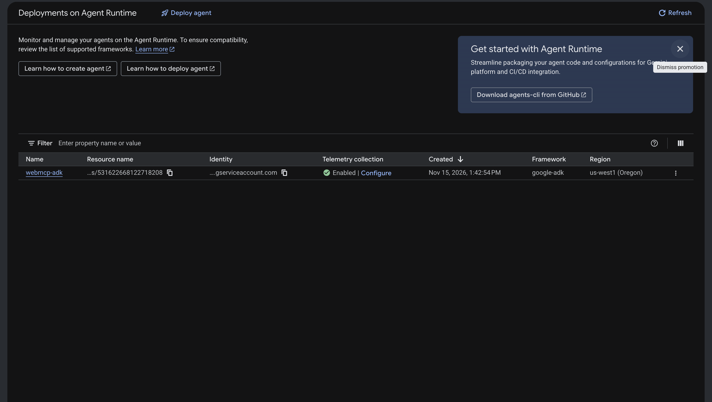

#### Overview Metrics (`Dashboard -> Overview`)
`4` sessions, `1.25` avg turns, `10` invocations, `27.667s` P95 latency, `41,483` input tokens, `3,911` output tokens.

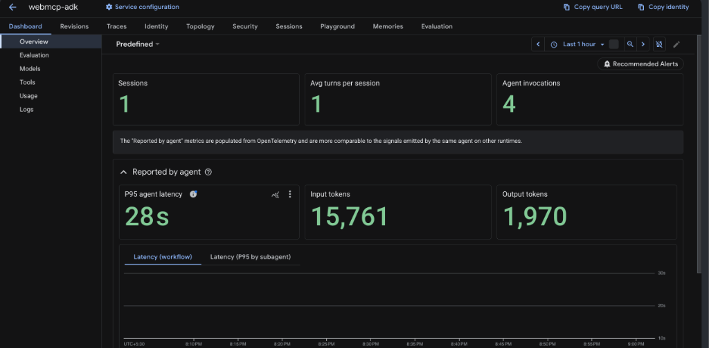

#### Model Telemetry (`Dashboard -> Models`)
`13` model calls for `gemini-3.8-flash` in the 15-minute window at `6.912s` P95 model latency.

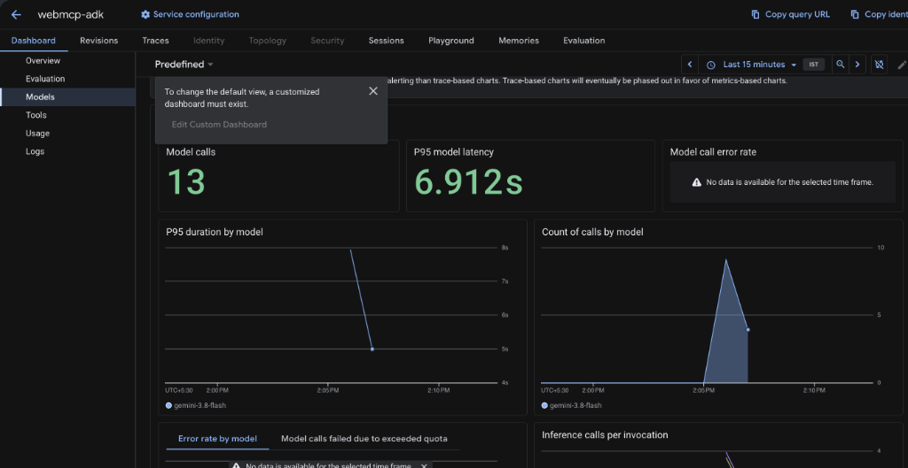

#### Tool Telemetry (`Dashboard -> Tools`)
`12` tool calls, `0.01s` P95 tool latency across all 7 WebMCP tools (`8.333%` error rate from deliberate `checkout_order` safety-gate test).

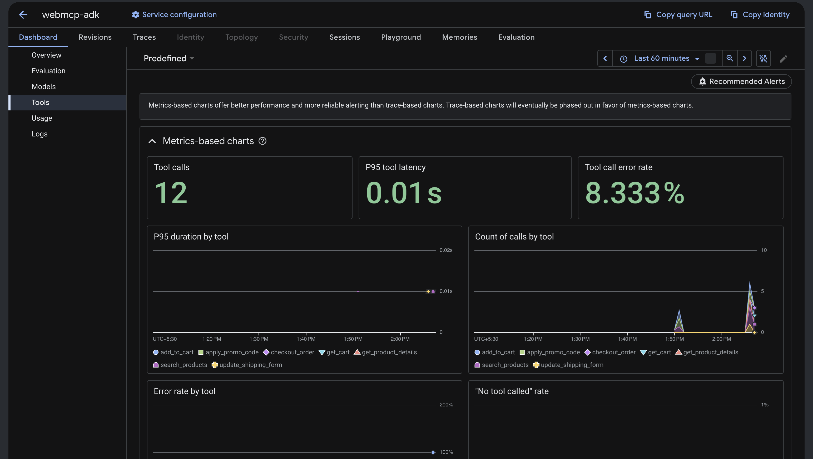

#### Token and Container Usage (`Dashboard -> Usage`)
Input/output token usage alongside container CPU (`0.404s` peak) and memory (`1.212GiB` peak) allocation.


#### Production Trace Waterfall & Span Graph (`Traces`)
Single `POST /run_sse` request (`19.741s`, `12` spans) across `invoke_workflow webmcp_agent`, `generate_content`, and WebMCP tools.

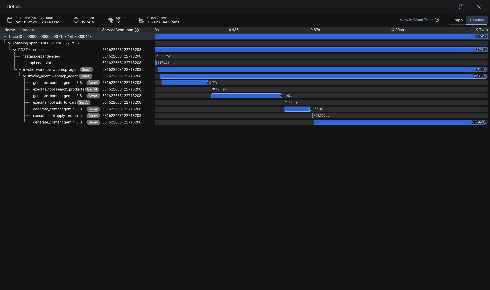

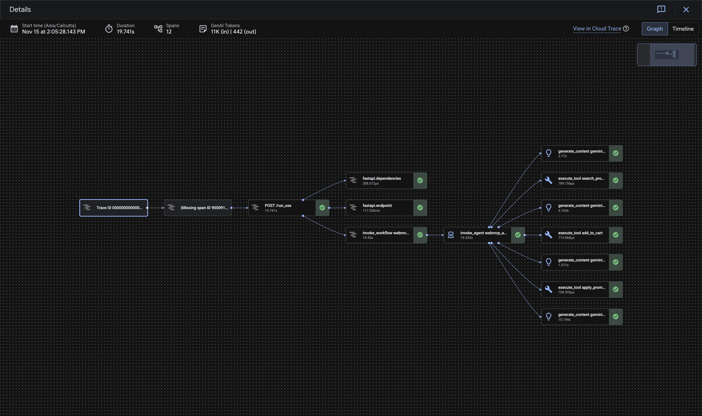

#### Active Sessions (`Sessions`)
Multi-turn ADK and A2A conversation threads (`demo-user`, `load-user-1`, `load-user-2`, A2A sessions).

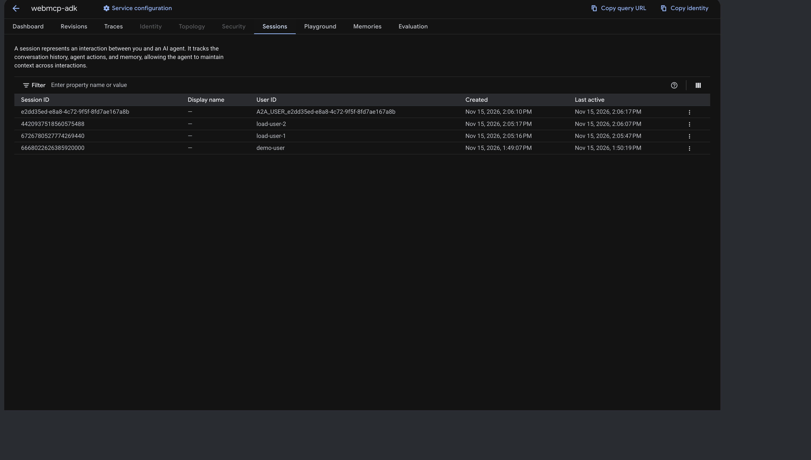

#### Revisions and Traffic (`Revisions`)
`1 of 1` active revision (`runtimeRevisions/1`) serving `100%` traffic.


#### Cloud Logging (`Dashboard -> Logs`)
`200 OK` responses on `/api/webmcp/status`, `/a2a/app/.well-known/agent-card.json`, `/run_sse`, and `/a2a/app`.


---

## License

Apache License 2.0. See the license headers in [`app/agent.py`](app/agent.py).
