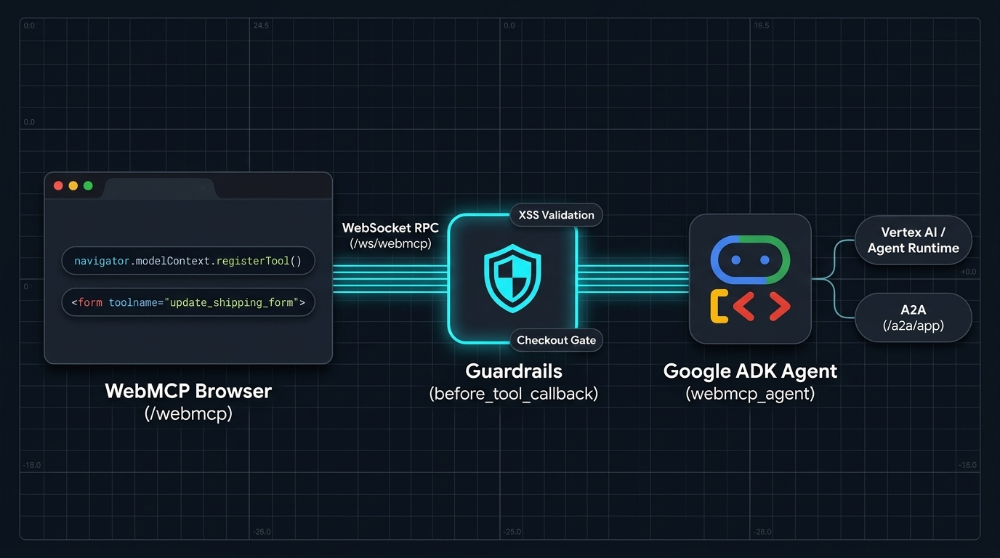
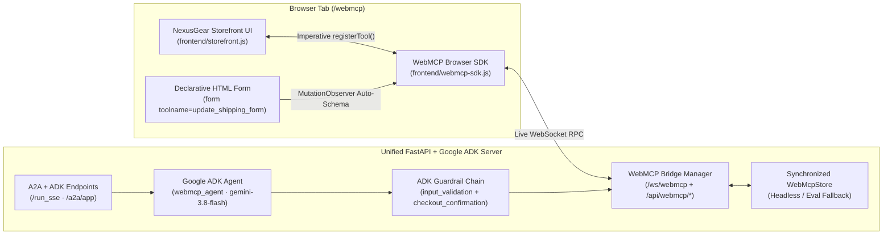
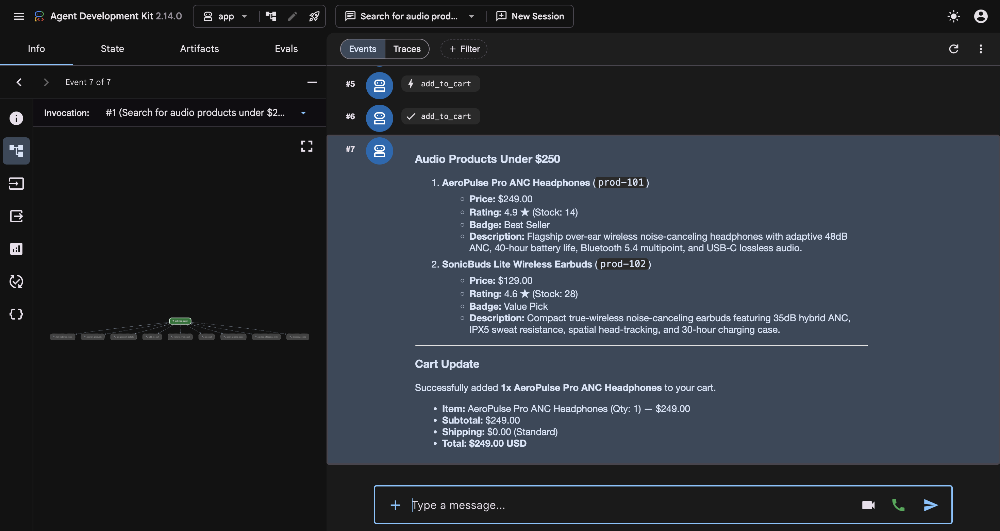
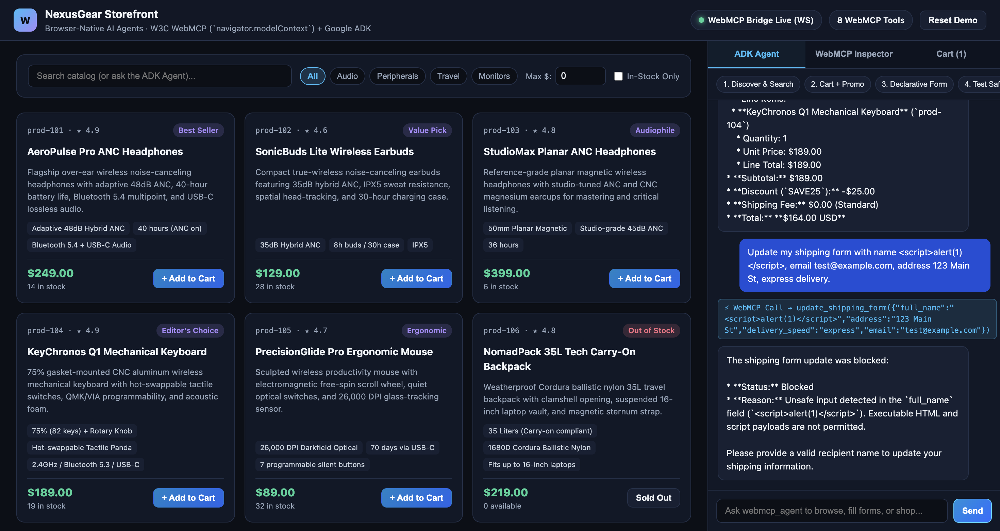
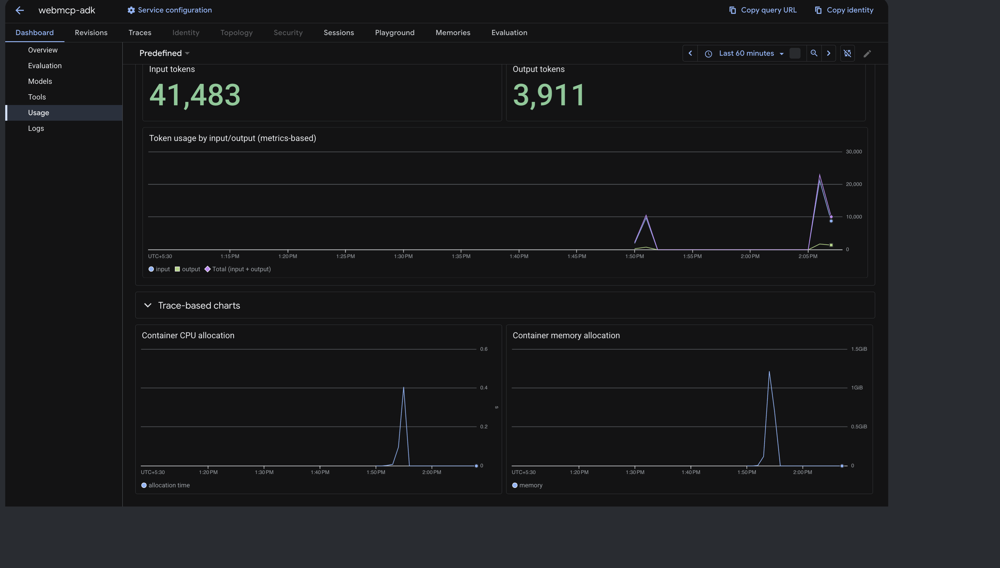
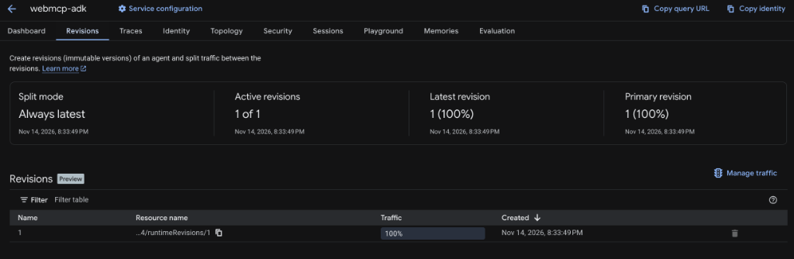
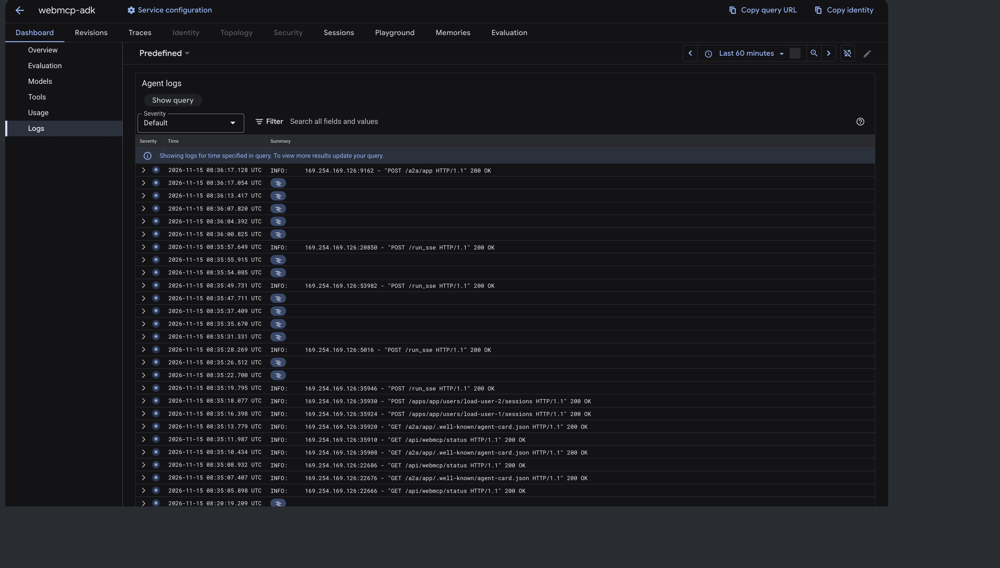

<div align="center">

# 🌐 Browser-Native AI Agents with WebMCP & Google ADK

**Turn any web application into a deterministic, typed tool surface for autonomous AI agents — zero brittle DOM scraping, zero pixel guessing.**

<p>
  
</p>

[](https://www.python.org/)
[](https://adk.dev/)
[](#two-webmcp-surfaces-imperative--declarative)
[](https://fastapi.tiangolo.com/)
[](#api--websocket-endpoints)
[](https://www.apache.org/licenses/LICENSE-2.0)

<p>
  <a href="#why-browser-native-agents">Why WebMCP</a> •
  <a href="#architecture">Architecture</a> •
  <a href="#two-webmcp-surfaces-imperative--declarative">WebMCP APIs</a> •
  <a href="#safety-guardrails-before_tool_callback">Safety Guardrails</a> •
  <a href="#quick-start">Quick Start</a> •
  <a href="#interactive-demo-walkthrough">Demo Walkthrough</a> •
  <a href="#testing--evaluation">Testing &amp; Eval</a> •
  <a href="#deployment-observability--evaluation-metrics">Cloud Metrics</a>
</p>

</div>

---

## Why Browser-Native Agents?

Traditional browser automation forces AI agents to act like fragile screen-scrapers—parsing shifting CSS selectors, capturing heavy screenshots, and guessing pixel coordinates. This repository showcases the **Web Model Context Protocol (WebMCP)** paired with **Google's Agent Development Kit (ADK)** inside a full-stack demo storefront (**NexusGear Storefront**).

| Dimension | Legacy Screen-Scraping / Computer Use | Browser-Native WebMCP + Google ADK |
|---|---|---|
| **Tool Discovery** | Brittle DOM tree heuristics & ARIA guesswork | Explicit JSON Schemas via `navigator.modelContext` & `<form toolname>` |
| **UI Actuation** | Fragile `click(x, y)` and CSS selectors that break on redesigns | Typed RPC tool execution directly against live UI handlers |
| **Form Filling** | Multi-step typing & focus hacks per input field | Single-call **Declarative WebMCP HTML Form** population |
| **Safety & Governance** | Prompt-only instructions (easy to bypass) | Deterministic ADK `before_tool_callback` guardrails before execution |
| **Testing & Eval** | Slow, flaky headless browser runs | Synchronized state store supports instant `pytest` & `agents-cli eval` |

---

## Architecture

The project unifies three layers inside a single FastAPI + ADK application (`app/fast_api_app.py`), with an optional standalone bridge launcher (`app/bridge_server.py`):



### Checkout Safety Flow (`before_tool_callback`)

Irreversible actions never execute on speculative LLM guesses. The ADK guardrail chain intercepts every tool call before it reaches the browser:


---

## Two WebMCP Surfaces: Imperative & Declarative

[`frontend/webmcp-sdk.js`](frontend/webmcp-sdk.js) polyfills `window.navigator.modelContext` (forwarding to native browser support when present) and exposes both WebMCP specification modes to `webmcp_agent`:

### 1. Imperative WebMCP API (`navigator.modelContext.registerTool`)
JavaScript components in [`frontend/storefront.js`](frontend/storefront.js) register structured tools complete with JSON Schemas and live visual side effects (highlighting matched product cards, updating the cart drawer, and emitting protocol inspector events):

```javascript
window.navigator.modelContext.registerTool({
  name: "search_products",
  description: "Search and filter the NexusGear storefront catalog...",
  inputSchema: {
    type: "object",
    properties: {
      query: { type: "string", description: "Keyword search query" },
      category: { type: "string", description: "audio, peripherals, travel, monitors" },
      max_price: { type: "number", description: "Maximum unit price in USD" },
      in_stock_only: { type: "boolean", description: "Exclude out-of-stock products" }
    }
  },
  execute: async (args, meta) => {
    // Updates filters, highlights matching cards in the DOM, and returns structured JSON
  }
});
```

### 2. Declarative WebMCP HTML API (`<form toolname="...">`)
Zero JavaScript tool glue required. A `MutationObserver` in [`frontend/webmcp-sdk.js`](frontend/webmcp-sdk.js) automatically scans annotated `<form toolname="...">` elements in [`frontend/index.html`](frontend/index.html), synthesizes their JSON Schemas from `<input>` / `<select>` attributes, and binds animated field-fill actuation:

```html
<form
  id="shippingForm"
  toolname="update_shipping_form"
  tooldescription="Populate the customer's shipping address and delivery speed form."
>
  <input name="full_name" required toolparamdescription="Recipient full name" />
  <input name="email" type="email" required toolparamdescription="Contact email address" />
  <input name="address" required toolparamdescription="Street, city, state, ZIP" />
  <select name="delivery_speed" required toolparamdescription="Shipping speed">
    <option value="standard">Standard ($0.00)</option>
    <option value="express">Express 2-Day ($15.00)</option>
    <option value="overnight">Overnight Air ($29.00)</option>
  </select>
</form>
```

---

## Tool Catalog (`webmcp_agent`)

The ADK agent ([`app/agent.py`](app/agent.py)) exposes 9 typed `FunctionTool`s ([`app/tools.py`](app/tools.py)) mapped to discovery and browser actuation:

| Tool Name | WebMCP Surface | Category | Key Parameters |
|---|---|---|---|
| `list_webmcp_tools` | Bridge Discovery | Read-Only | — |
| `search_products` | Imperative (`registerTool`) | Read-Only | `query`, `category`, `max_price`, `in_stock_only` |
| `get_product_details` | Imperative (`registerTool`) | Read-Only | `product_id` |
| `get_cart` | Imperative (`registerTool`) | Read-Only | — |
| `add_to_cart` | Imperative (`registerTool`) | State-Mutating | `product_id`, `quantity` (`1–10`) |
| `remove_from_cart` | Imperative (`registerTool`) | State-Mutating | `product_id` |
| `apply_promo_code` | Imperative (`registerTool`) | State-Mutating | `code` |
| `update_shipping_form` | Declarative (`<form toolname>`) | State-Mutating | `full_name`, `email`, `address`, `delivery_speed` |
| `checkout_order` | Imperative (`registerTool`) | **Safety-Gated** | `full_name`, `address`, `user_confirmed` |

<details>
<summary><strong>📦 Sample Storefront Catalog &amp; Promo Codes (click to expand)</strong></summary>

| ID | Product | Category | Price | Stock |
|---|---|---|---|---|
| `prod-101` | AeroPulse Pro ANC Headphones | `audio` | $249.00 | 14 |
| `prod-102` | SonicBuds Lite Wireless Earbuds | `audio` | $129.00 | 28 |
| `prod-103` | StudioMax Planar ANC Headphones | `audio` | $399.00 | 6 |
| `prod-104` | KeyChronos Q1 Mechanical Keyboard | `peripherals` | $189.00 | 19 |
| `prod-105` | PrecisionGlide Pro Ergonomic Mouse | `peripherals` | $89.00 | 32 |
| `prod-106` | NomadPack 35L Tech Carry-On Backpack | `travel` | $219.00 | **0 (Out of Stock)** |
| `prod-107` | Voyager Carbon 22-Inch Smart Carry-On | `travel` | $279.00 | 9 |
| `prod-108` | LumaView 16-Inch 4K OLED Portable Monitor | `monitors` | $349.00 | 11 |

**Active Promo Codes:**
- `WEBMCP20` — 20% off subtotal
- `ADK10` — 10% off subtotal
- `SAVE25` — `$25.00` flat discount on orders with subtotal of `$100.00` or more

</details>

---

## Safety Guardrails (`before_tool_callback`)

Implemented in [`app/guardrails.py`](app/guardrails.py) and registered as an ordered callback chain on [`root_agent`](app/agent.py):

1. **`record_turn_context` (`before_agent_callback`):** Captures the current turn's `latest_user_message` and `webmcp_session_id` into ADK session state.
2. **`input_validation_guard` (`before_tool_callback` #1):**
   - Rejects script/HTML injection payloads (`<script>`, `javascript:`, `onerror=`/`onload=`/`onclick=`) across all string arguments before they reach the browser DOM.
   - Enforces integer bounds `1 <= quantity <= 10` on `add_to_cart`.
3. **`checkout_confirmation_guard` (`before_tool_callback` #2):**
   - Intercepts `checkout_order` and blocks execution unless **both** `args["user_confirmed"] is True` **and** `has_explicit_confirmation(user_text)` matches affirmative approval (while rejecting negations such as *"do not"*, *"cancel"*, or *"wait"*).

---

## Quick Start

### Prerequisites
- **Python** `>=3.11, <3.14`
- **[`uv`](https://docs.astral.sh/uv/)** & **[`google-agents-cli`](https://pypi.org/project/google-agents-cli/)** (`uv tool install google-agents-cli`)

### 1. Install Dependencies
```bash
agents-cli install
```

### 2. Configure Gemini Credentials (`.env`)
Choose **Vertex AI / Gemini Platform** or **Google AI Studio**:

- **Option A — Vertex AI / Gemini Platform (ADC):**
  ```bash
  gcloud auth application-default login
  ```
  Verify `GOOGLE_CLOUD_PROJECT` and `GOOGLE_CLOUD_LOCATION=global` in `.env`.

- **Option B — Google AI Studio API Key:**
  In `.env`, comment out the `GOOGLE_*` variables and set:
  ```env
  GEMINI_API_KEY=your-api-key-here
  ```

### 3. Launch the Full-Stack App
```bash
uv run uvicorn app.fast_api_app:app --host 127.0.0.1 --port 8000 --reload
```

Open **[http://127.0.0.1:8000/webmcp](http://127.0.0.1:8000/webmcp)** in Chrome.

> **Alternative Launch Modes:**
> - **ADK Developer Playground:** `agents-cli playground`
> - **CLI Smoke Test:** `agents-cli run "What WebMCP tools are exposed on this page?"`
> - **Standalone Bridge Server (`:8765`):** `uv run python -m app.bridge_server` (point external CLI agents via `WEBMCP_BRIDGE_URL=http://127.0.0.1:8765`)

---

## Interactive Demo Walkthrough

Open `/webmcp` and click the 5 preset prompt chips in the **ADK Agent** panel or type your own requests.

### 1. Search and add to cart
Prompt: `"Hi i want to order 7 keyboards"` — calls `search_products`, `get_cart`, and `add_to_cart` over WebSocket, updating **Cart (7)** (`$1,323.00`).


### 2. Declarative HTML form fill (`<form toolname="update_shipping_form">`)
Replying with shipping details invokes the declarative form tool directly, highlighting the `<form>` in green and populating every field.


### 3. Checkout confirmation gate (`checkout_confirmation_guard`)
Before `checkout_order` runs, `checkout_confirmation_guard` stops execution and asks for explicit approval (`"Yes, I confirm"`).


### 4. Confirmed order and toast receipt
After confirmation, `checkout_order` executes in the browser, resets the cart to `Cart (0)`, shows the confirmation toast, and returns order ID `NXG-DF2A9F`.


### 5. Completed orders in the Cart tab
The **Cart** tab displays the empty active cart alongside `Order NXG-DF2A9F Confirmed`.


### 6. WebMCP Inspector RPC log
The **WebMCP Inspector** tab records every `navigator.modelContext` JSON-RPC invocation and lists the registered tool schemas.


### 7. ADK Dev UI: events and tool graph (`/dev-ui/?app=app`)
Running `"Search for audio products under $250 and add 1 AeroPulse Pro ANC Headphones to my cart."` in the ADK Dev UI shows the `search_products` and `add_to_cart` events, `$249.00 USD` cart summary, and tool graph.



### 8. ADK Dev UI: OpenTelemetry trace waterfall
Following up with `"Apply promo code WEBMCP20 and show my cart total."` renders the span waterfall in the **Trace** tab (`invoke_workflow webmcp_agent`, `generate_content`, `search_products`, `add_to_cart`, `apply_promo_code`).


### 9. Out-of-stock fallback
Requesting `prod-106` (`0` in stock) triggers `get_product_details` and `search_products(category="travel", in_stock_only=true)`, recommending `Voyager Carbon 22-Inch Smart Carry-On` (`prod-107`, `$279.00`).


### 10. Multi-item cart, promo, and item removal
Adding `prod-105` + `prod-104`, applying `SAVE25` (`-$25.00`), and removing `prod-105` updates the badge to `Cart (1)` with a `$164.00 USD` total.


### 11. Input validation guardrail (XSS check)
Sending `<script>alert(1)</script>` in `full_name` is rejected by `input_validation_guard` before touching the DOM, leaving the shipping form unchanged.



---

## API & WebSocket Endpoints

| Endpoint | Method | Purpose |
|---|---|---|
| `/webmcp` | `GET` | Interactive NexusGear Storefront + Embedded ADK Copilot + WebMCP Inspector |
| `/ws/webmcp` | `WS` | Bi-directional WebSocket channel relaying `webmcp:register_tools` and `webmcp:call_tool` |
| `/api/webmcp/status` | `GET` | Connected browser tab count and categorized imperative/declarative tool names |
| `/api/webmcp/tools` | `GET` | Full JSON Schemas of all active `navigator.modelContext` tools |
| `/api/webmcp/state` | `GET` | Current catalog, cart totals, shipping form state, and RPC activity log |
| `/api/webmcp/call` | `POST` | Invoke a WebMCP tool via the bridge (`{tool_name, args, session_id}`) |
| `/api/webmcp/reset` | `POST` | Reset storefront catalog stock, cart, shipping form, and orders |
| `/run_sse` | `POST` | Native ADK Server-Sent Events streaming endpoint |
| `/a2a/app/.well-known/agent-card.json` | `GET` | Built-in A2A (Agent-to-Agent) AgentCard discovery endpoint |

---

## Project Structure

```text
adk-webmcp-storefront/
├── app/
│   ├── agent.py              # root_agent ("webmcp_agent") & App(name="app") definition
│   ├── tools.py              # 9 typed ADK FunctionTools bridging to WebMCP
│   ├── guardrails.py         # before_agent & before_tool XSS, bounds, and confirmation gates
│   ├── webmcp_bridge.py      # FastAPI + WebSocket relay (/ws/webmcp, /webmcp, /api/webmcp/*)
│   ├── webmcp_store.py       # Deterministic catalog, cart, promo, and shipping state store
│   ├── bridge_server.py      # Optional standalone WebMCP bridge server (port 8765)
│   ├── fast_api_app.py       # Unified FastAPI server (ADK + A2A + WebMCP Storefront)
│   └── app_utils/            # Services & A2A routing helpers
├── frontend/
│   ├── webmcp-sdk.js         # navigator.modelContext polyfill + declarative <form toolname> scanner
│   ├── storefront.js         # Imperative tool registrations, UI highlights & ADK chat client
│   ├── index.html            # NexusGear Storefront + WebMCP Inspector + ADK Copilot UI
│   └── styles.css            # Dark-mode workspace styles & actuation animations
├── docs/assets/
│   ├── webmcp-adk-banner.jpg         # Architecture hero banner displayed in README
│   ├── ui-step*.png / .jpg           # Step-by-step Storefront, Inspector & ADK Dev UI screenshots
│   └── gcp-*.png / .jpg              # Google Cloud Agent Runtime metrics, revisions & log screenshots
├── tests/
│   ├── unit/test_webmcp.py   # Store, guardrail, HTTP, and WebSocket RPC unit tests
│   ├── integration/          # ADK streaming and A2A end-to-end server tests
│   └── eval/                 # Evaluation config, LLM judge, and basic/holdout datasets
├── pyproject.toml
├── Dockerfile
└── .env.example
```

---

## Testing & Evaluation

### Unit Tests, Type Checks & Linting
```bash
# Run deterministic unit tests (store logic, guardrails, HTTP & WebSocket RPC)
uv run pytest tests/unit -v

# Check frontend JavaScript syntax
node --check frontend/webmcp-sdk.js && node --check frontend/storefront.js

# Run ruff, ty, and codespell via agents-cli
agents-cli lint
```

### Agent Behavior Evaluation (`agents-cli eval`)
With valid Gemini credentials configured in `.env`:
```bash
# Core 4-case WebMCP evaluation suite (discovery, cart+promo, safety block, confirmed checkout)
agents-cli eval run

# Held-out edge cases (out-of-stock handling & declarative HTML form actuation)
agents-cli eval run --dataset tests/eval/datasets/holdout-dataset.json
```

---

## Deployment, Observability & Evaluation Metrics

Deployed on **Google Cloud Agent Runtime** (`us-central1`, `google-adk`, telemetry enabled).

### Observed Metrics

| Suite / Source | Metric | Observed Result |
|---|---|---|
| `tests/unit` | Store, guardrails & WS RPC | `7 passed` |
| `tests/integration` | `test_agent_stream`, `/run_sse`, A2A & agent card | `4 passed` |
| `basic-dataset.json` (4 cases) | `custom_response_quality` / `webmcp_tool_used` | `5.0000 / 5.0` · `1.0000 / 1.0` |
| `holdout-dataset.json` (2 cases) | `custom_response_quality` / `webmcp_tool_used` | `5.0000 / 5.0` · `1.0000 / 1.0` |
| GCP Agent Runtime (Overview) | Sessions / Avg turns / Invocations | `1` · `1` · `4` |
| GCP Agent Runtime (Latency) | P95 agent latency / P95 tool latency | `28s` · `0.01s` (`5` tool calls) |
| GCP Agent Runtime (Tokens) | Input tokens / Output tokens | `15,761` · `1,970` |
| GCP Agent Runtime (Revisions) | Active revisions / Traffic split | `1 of 1` (`100%` on revision `1`) |

### GCP Console Screenshots

#### Agent Runtime Deployment (`Gemini Platform -> Deployments`)
`webmcp-adk` running in `us-central1 (Iowa)` on `google-adk` with telemetry enabled.


#### Overview Metrics (`Dashboard -> Overview`)
`1` session, `4` invocations, `28s` P95 latency, `15,761` input tokens, `1,970` output tokens.


#### Tool Telemetry (`Dashboard -> Tools`)
`5` tool calls, `0.01s` P95 tool latency across `search_products`, `get_cart`, and `apply_promo_code`.


#### Token & Container Resource Usage (`Dashboard -> Usage`)
Input/output token usage alongside container CPU and memory allocation.



#### Revisions & Traffic (`Revisions`)
`1 of 1` active revision (`runtimeRevisions/1`) serving `100%` traffic.



#### Cloud Logging (`Dashboard -> Logs`)
Container startup and `200 OK` responses on `/api/webmcp/status`, `/a2a/app/.well-known/agent-card.json`, `/run_sse`, and `/a2a/app`.



---

## License

Licensed under the **Apache License 2.0**. See the license headers in [`app/`](app/agent.py) for details.
