# Stop Scraping the DOM: Build Browser-Native AI Agents with WebMCP and Google ADK

Every time we ask an AI agent to use a website on our behalf, we force it to guess. Today's browser agents take screenshots, parse messy DOM trees, and hope a CSS selector doesn't break on the next deploy. When a button moves 20 pixels or a class name changes, the automation fails.

The **Web Model Context Protocol (WebMCP)** fixes this at the browser layer. Instead of making an AI guess how a page works, the website itself exposes structured, typed tools through `navigator.modelContext` and annotated HTML forms. You can read the official specification and Chrome guide at [developer.chrome.com/docs/ai/webmcp](https://developer.chrome.com/docs/ai/webmcp).

To see how this works for real end users, I built **NexusGear Storefront**—a full-stack shopping app where a **Google ADK** agent (`webmcp_agent`) searches products, fills shipping forms, enforces checkout guardrails, and places orders directly through WebMCP. Below is the system architecture connecting the browser tab to the ADK agent over WebSockets.

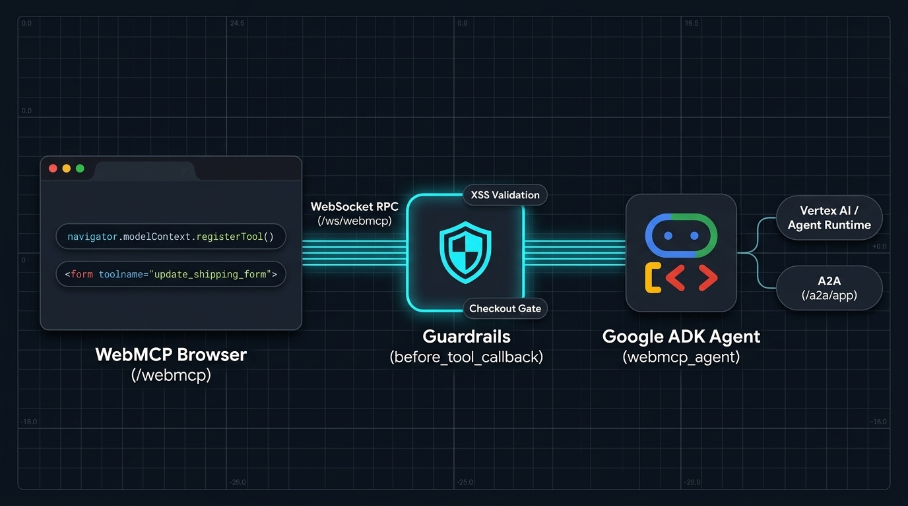
*Architecture of the NexusGear Storefront: browser-side `navigator.modelContext` tools bridged over WebSocket to a Google ADK agent.*

You can explore the full source code on GitHub: [sanketbisne/adk-webmcp-storefront](https://github.com/sanketbisne/adk-webmcp-storefront).

---

## How WebMCP Works Under the Hood

WebMCP gives web developers two ways to turn any web page into an agent-ready interface, both documented on [Chrome for Developers](https://developer.chrome.com/docs/ai/webmcp). The diagram below contrasts this browser-native contract with traditional DOM scraping.

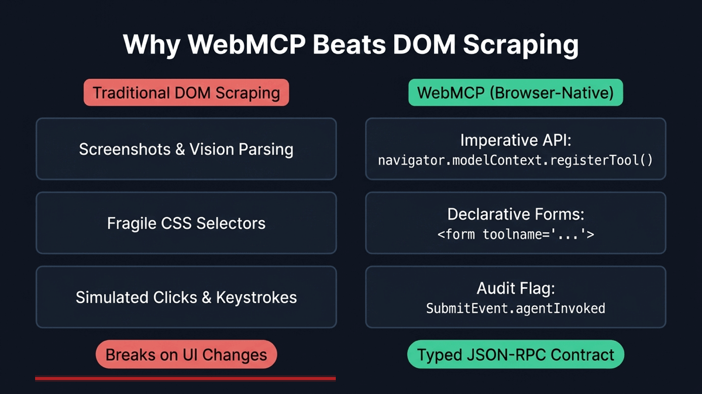
*Traditional DOM scraping vs. WebMCP's typed browser-native contract (`navigator.modelContext.registerTool()`, `<form toolname>`, and `SubmitEvent.agentInvoked`).*

### 1. The Imperative API (`navigator.modelContext.registerTool`)

When your app manages dynamic JavaScript state—filtering a product catalog, updating a shopping cart, or applying a promo code—register a tool directly in JavaScript with a name, description, JSON Schema (`inputSchema`), and an async `execute` function. Always feature-detect `'modelContext' in navigator` first (and in `frontend/webmcp-sdk.js`, a polyfill relays calls over `/ws/webmcp` so the storefront works in browsers without native support yet):

```javascript
if ("modelContext" in navigator) {
  window.navigator.modelContext.registerTool({
    name: "search_products",
    description:
      "Search and filter the NexusGear storefront catalog by keyword, category (audio, peripherals, travel, monitors), maximum price, or stock availability.",
    inputSchema: {
      type: "object",
      properties: {
        query: { type: "string", description: "Keyword search query" },
        category: {
          type: "string",
          description: "Category filter (audio, peripherals, travel, monitors)",
        },
        max_price: {
          type: "number",
          description: "Maximum unit price in USD (0 for no limit)",
        },
        in_stock_only: {
          type: "boolean",
          description: "Whether to exclude out-of-stock products",
        },
      },
    },
    execute: async (args) => {
      // Updates UI filters, highlights matching product cards, and returns structured JSON
    },
  });
}
```

When an end user asks the agent to find noise-canceling headphones, the agent never simulates keystrokes in a search box. It calls `search_products`, the storefront filters and highlights the matching cards in real time, and the agent receives deterministic JSON back.

### 2. The Declarative Form API (`<form toolname="...">`)

For standard HTML forms, you do not need to write a single line of tool-registration JavaScript. By adding `toolname` and `tooldescription` to a `<form>` element—and optional `toolparamdescription` attributes on inputs (falling back to `<label>` or `aria-description` when omitted)—Chrome automatically turns that form into a JSON-Schema tool:

```html
<form
  id="shippingForm"
  toolname="update_shipping_form"
  tooldescription="Populate the customer's shipping address and delivery speed form."
>
  <input name="full_name" required toolparamdescription="Recipient full name" />
  <input name="email" type="email" required toolparamdescription="Contact email address" />
  <input name="address" required toolparamdescription="Street, city, state, ZIP" />
  <select name="delivery_speed" required toolparamdescription="Shipping speed">
    <option value="standard">Standard ($0.00)</option>
    <option value="express">Express 2-Day ($15.00)</option>
    <option value="overnight">Overnight Air ($29.00)</option>
  </select>
</form>
```

WebMCP also sets `SubmitEvent.agentInvoked = true` when an agent triggers a form submission, so your backend and analytics can always distinguish human clicks from agent-driven submissions.

---

## What the End-User Experience Looks Like

Let's walk through a real shopping session in Chrome at `/webmcp` using `webmcp_agent` (`gemini-3.8-flash`).

### Step 1: Searching and Adding to Cart

Suppose a shopper types: `"Search for audio products under $250 and add 1 AeroPulse Pro ANC Headphones to my cart."`. Behind the scenes, the agent discovers the catalog via `search_products`, checks existing items with `get_cart`, and calls `add_to_cart` over the WebSocket bridge. The storefront immediately updates the cart badge to **Cart (1)** (`$249.00 USD`) as shown below.

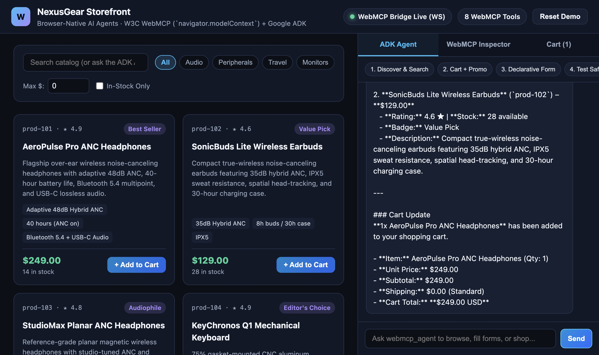
*The agent searches the catalog, adds 1 AeroPulse Pro ANC Headphones, and summarizes the cart.*

### Step 2: Filling the Declarative Shipping Form

Next, the user replies with their name, email, address, and delivery preference in plain English (`sanket bisne`, `sanketbisne@gmail.com`, `Nagpur`). Because `<form toolname="update_shipping_form">` exposes its fields as a WebMCP tool, the agent fills all four inputs in one shot and highlights the form in green so the user can visually verify every field.

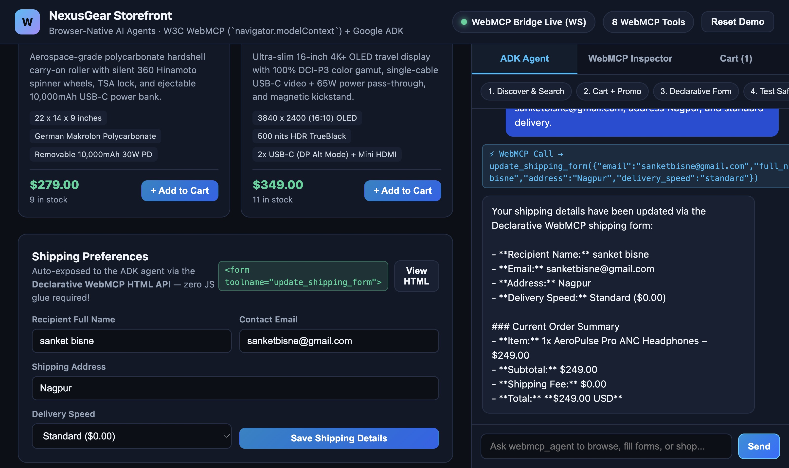
*Declarative WebMCP form actuation: zero custom JS tool glue needed.*

### Step 3: Enforcing Safety Guardrails Before Checkout

Prompting an LLM with *"never buy without asking"* is not enough for real-world payments. In Google ADK, I attached a deterministic Python `before_tool_callback` chain in `app/guardrails.py`. When `checkout_order` is invoked, `checkout_confirmation_guard` verifies both `user_confirmed=True` and that the user's latest message explicitly confirms the order without negation words like `"cancel"`, `"wait"`, or `"do not"`. If either check fails, the guardrail blocks the tool call before it ever reaches the browser:

```python
async def checkout_confirmation_guard(
    tool: BaseTool,
    args: dict[str, Any],
    tool_context: ToolContext,
) -> dict[str, Any] | None:
    if tool.name != "checkout_order":
        return None

    user_text = extract_content_text(
        getattr(tool_context, "user_content", None)
    ) or str(tool_context.state.get("latest_user_message", ""))

    if args.get("user_confirmed") is not True or not has_explicit_confirmation(
        user_text
    ):
        return {
            "status": "confirmation_required",
            "error": (
                "CHECKOUT BLOCKED BY SAFETY GUARDRAIL: ask the user to reply "
                "with 'Yes, I confirm' to place the order."
            ),
        }
    return None
```

```python
async def checkout_confirmation_guard(
    tool: BaseTool,
    args: dict[str, Any],
    tool_context: ToolContext,
) -> dict[str, Any] | None:
    if tool.name != "checkout_order":
        return None

    user_text = extract_content_text(
        getattr(tool_context, "user_content", None)
    ) or str(tool_context.state.get("latest_user_message", ""))

    if args.get("user_confirmed") is not True or not has_explicit_confirmation(
        user_text
    ):
        return {
            "status": "confirmation_required",
            "error": (
                "CHECKOUT BLOCKED BY SAFETY GUARDRAIL: ask the user to reply "
                "with 'Yes, I confirm' to place the order."
            ),
        }
    return None
```

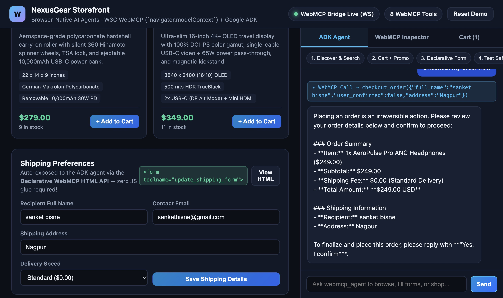
*`checkout_confirmation_guard` stops `checkout_order` and asks for explicit confirmation.*

### Step 4: Confirmed Order and Receipt Summary

Once the user replies `"Yes, I confirm"`, the guardrail permits `checkout_order` to execute in the browser. The storefront resets the active cart to `Cart (0)`, generates order ID `NXG-489625` for `$249.00 USD` (`sanket bisne`, `Nagpur`), and displays the confirmed receipt in chat.

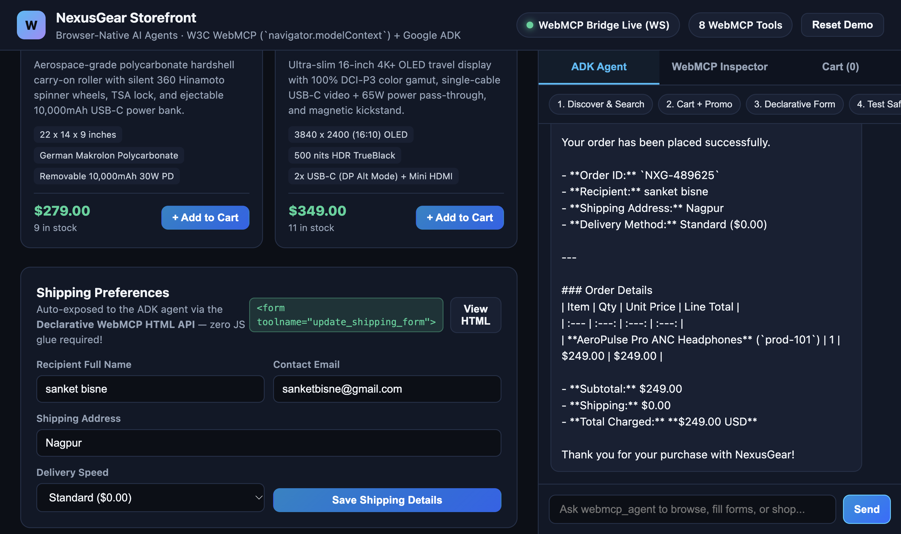
*Confirmed order `NXG-489625` after explicit confirmation.*

### Step 5: Verifying Completed Orders in the Cart Tab

Opening the **Cart** tab confirms the active cart is cleared (`Cart (0)`) and shows the finalized receipt under **Completed Orders** (`Order NXG-489625 Confirmed`, `$249.00`) so the user has an immediate audit trail.

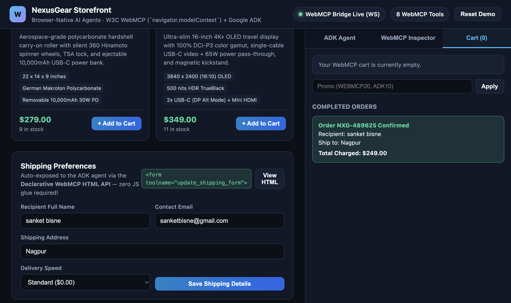
*Order `NXG-489625` logged under completed orders.*

### Step 6: Inspecting Raw WebMCP JSON-RPC Calls

To make every agent action transparent to developers, the storefront includes a **WebMCP Inspector** tab. It logs every `navigator.modelContext` tool registration and JSON-RPC call in real time alongside its arguments and return payload.

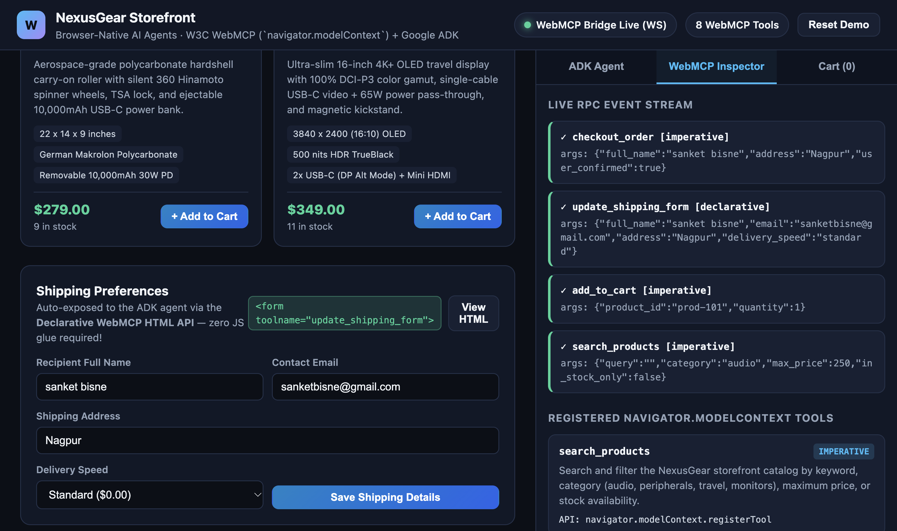
*Live JSON-RPC activity log and registered tool schemas inside the WebMCP Inspector.*

---

## Inspecting Edge Cases in Google ADK Dev UI

Because the backend mirrors storefront state in a synchronized `WebMcpStore` when no browser tab is connected, I can also test and debug the agent directly inside ADK's Dev UI (`/dev-ui/?app=app`).

### Step 7: Events and Tool Graphs

When a user asks `"Search for audio products under $250 and add 1 AeroPulse Pro ANC Headphones to my cart."`, ADK Dev UI displays the exact sequence of `search_products` and `add_to_cart` events, the `$249.00 USD` cart summary, and the generated tool execution graph.

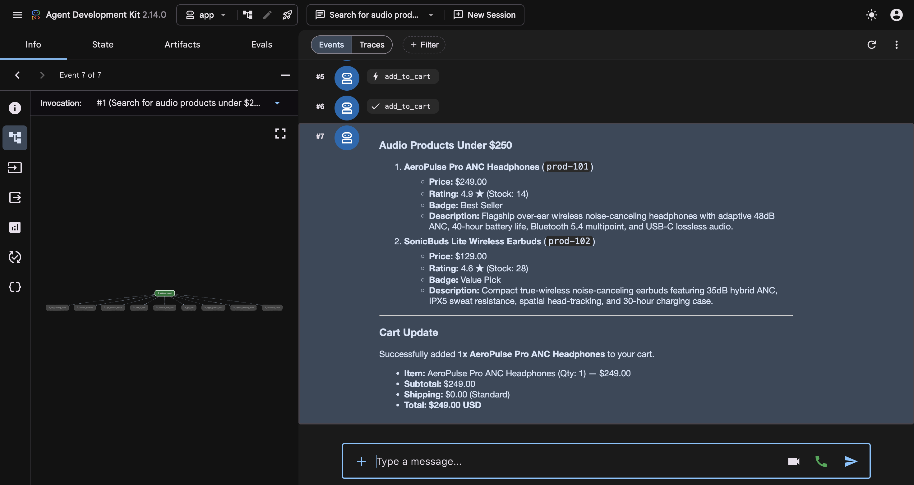
*ADK Dev UI showing `search_products` and `add_to_cart` calls and the resulting tool graph.*

### Step 8: OpenTelemetry Trace Waterfalls

Following up with `"Apply promo code WEBMCP20 and show my cart total."` captures an end-to-end OpenTelemetry waterfall in the **Trace** tab—breaking down `invoke_workflow webmcp_agent`, `generate_content`, `search_products`, `add_to_cart`, and `apply_promo_code`.

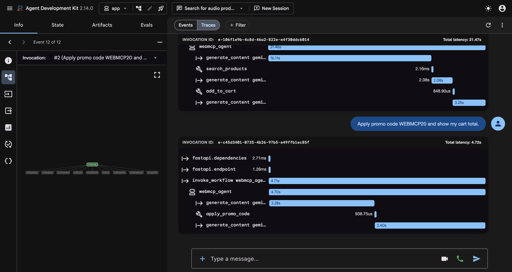
*OpenTelemetry trace waterfall across `invoke_workflow webmcp_agent`, `generate_content`, and WebMCP tool calls.*

### Step 9: Handling Out-of-Stock Products

When a shopper asks for `prod-106` (NomadPack 35L backpack, which has `0` stock), the agent inspects `get_product_details`, sees it is sold out, automatically runs `search_products(category="travel", in_stock_only=true)`, and recommends an in-stock alternative (`prod-107`).

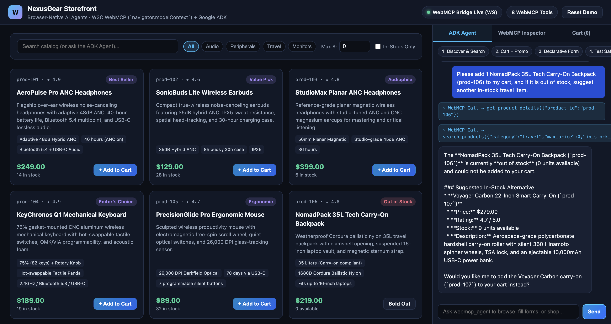
*Automatic fallback to an in-stock travel item when `prod-106` is sold out.*

### Step 10: Multi-Item Carts, Promo Codes, and Item Removal

Adding multiple items (`prod-105` and `prod-104`), applying `SAVE25` (`-$25.00` on orders of `$100.00+`), and removing an item updates the cart badge to `Cart (1)` and recalculates the total to `$164.00 USD`.

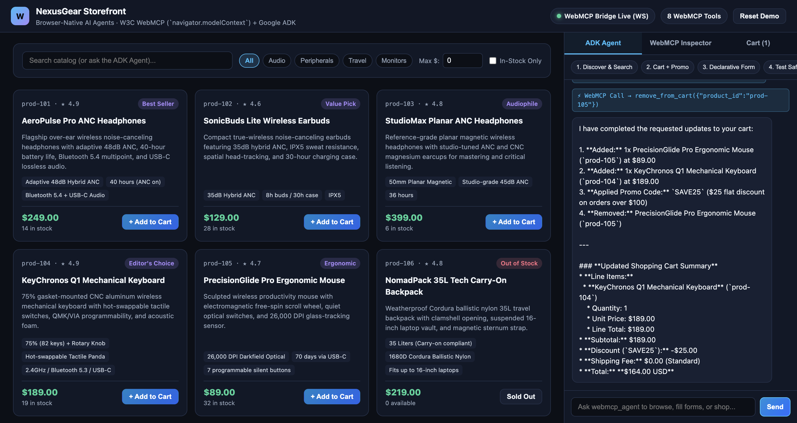
*Cart mutation and promo recalculation.*

### Step 11: Blocking XSS Payloads Before They Touch the DOM

Every string argument passes through `input_validation_guard` (`before_tool_callback`) before reaching the browser. When someone submits `<script>alert(1)</script>` in `full_name`, the guardrail rejects the call immediately and leaves the shipping form untouched.

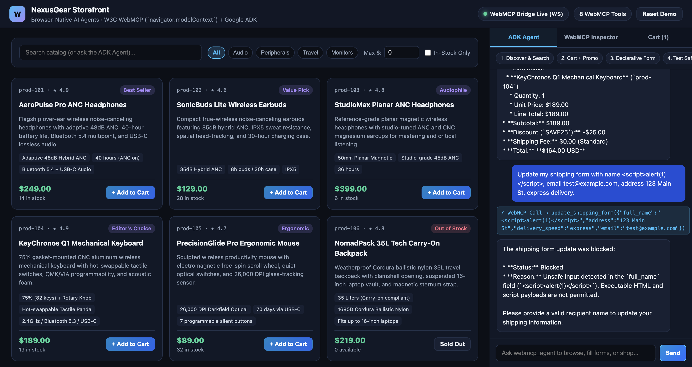
*`input_validation_guard` blocking an XSS payload before it reaches the browser.*

---

## Scaffolding, Testing, and Evaluating with `agents-cli`

Shipping an agent without automated evaluation is guesswork. I structured `webmcp-adk` using **`agents-cli`** (`agents-cli-manifest.yaml` with the `adk_python` template, `root_agent_name: "webmcp_agent"`, `is_a2a: true`, and `deployment_target: "agent_runtime"` in `us-west1`). That gives us a single CLI workflow from local debugging (`agents-cli playground`) to evaluation (`agents-cli eval run`) to production deployment (`agents-cli deploy`), as illustrated below.

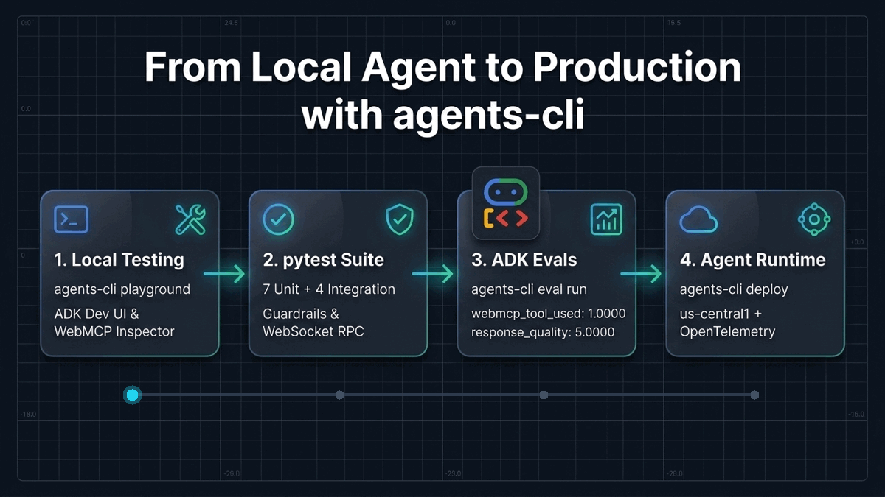
*The `agents-cli` workflow taking `webmcp-adk` from local debugging to `pytest`, ADK evals, and Google Cloud Agent Runtime.*

Because WebMCP gives `webmcp_agent` a typed tool contract backed by `WebMcpStore`, we can test both deterministic business logic and end-to-end agent behavior without spinning up a headless browser for every run:

1. **Unit and Integration Tests (`pytest`):**
   - `uv run pytest tests/unit -v`: **7 passed** covering catalog search, cart math, promo rules, XSS and confirmation guardrails, and WebSocket RPC.
   - `uv run --env-file .env pytest tests/integration -v`: **4 passed** covering `test_agent_stream`, `/run_sse`, and A2A agent-card discovery.

2. **ADK Evaluation Suites (`agents-cli eval run`):**
   We configured `tests/eval/eval_config.yaml` with two custom metrics and ran them against `basic-dataset.json` (4 core scenarios: discovery, cart + promo, checkout safety block, confirmed checkout) and `holdout-dataset.json` (2 unseen edge cases: out-of-stock fallback and declarative HTML form fill):

   ```bash
   agents-cli eval run --dataset tests/eval/datasets/basic-dataset.json
   agents-cli eval run --dataset tests/eval/datasets/holdout-dataset.json
   ```

   You can also decouple trace generation from grading (`agents-cli eval generate` followed by `agents-cli eval grade`) or compare runs for regressions (`agents-cli eval compare`). Here is how each metric scored:
   - **`webmcp_tool_used`**: Inspects `agent_data` to verify real `function_call` invocations occurred instead of hallucinated responses. Score: **1.0000 / 1.0** on both suites.
   - **`custom_response_quality`**: Uses an in-process LLM-as-judge (`tests/eval/response_quality.py`, `gemini-3.8-flash` at `temperature=0` with a structured Pydantic `_Verdict` schema) to grade accuracy, relevance, clarity, and ground-truth agreement on a 1–5 scale. Score: **5.0000 / 5.0** on both suites.

---

## Deploying via `agents-cli` to Google Cloud Agent Runtime

Once all unit tests, integration tests, and ADK evals passed, deploying to **Google Cloud Agent Runtime** (`us-west1`, `google-adk` runtime) is a single command:

```bash
agents-cli deploy
```

Because `agents-cli-manifest.yaml` targets `agent_runtime` with OpenTelemetry enabled, the deployment automatically wires up tracing, tool telemetry, and revision management. You can see the active `webmcp-adk` deployment and telemetry status in the GCP Console below.

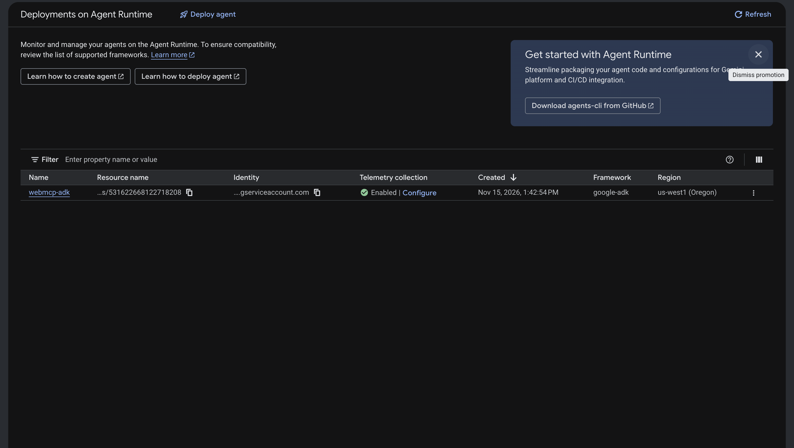
*`webmcp-adk` deployed on Google Cloud Agent Runtime in `us-west1 (Oregon)` with telemetry enabled.*

After generating live multi-session traffic, the **Overview** dashboard (`Last 60 minutes`) tracks top-level adoption and end-to-end workflow latency (`p50`, `p95`, `p99`): 4 sessions, 1.25 average turns per session, 10 agent invocations, a 27.667s P95 agent latency, 41,483 input tokens, and 3,911 output tokens.

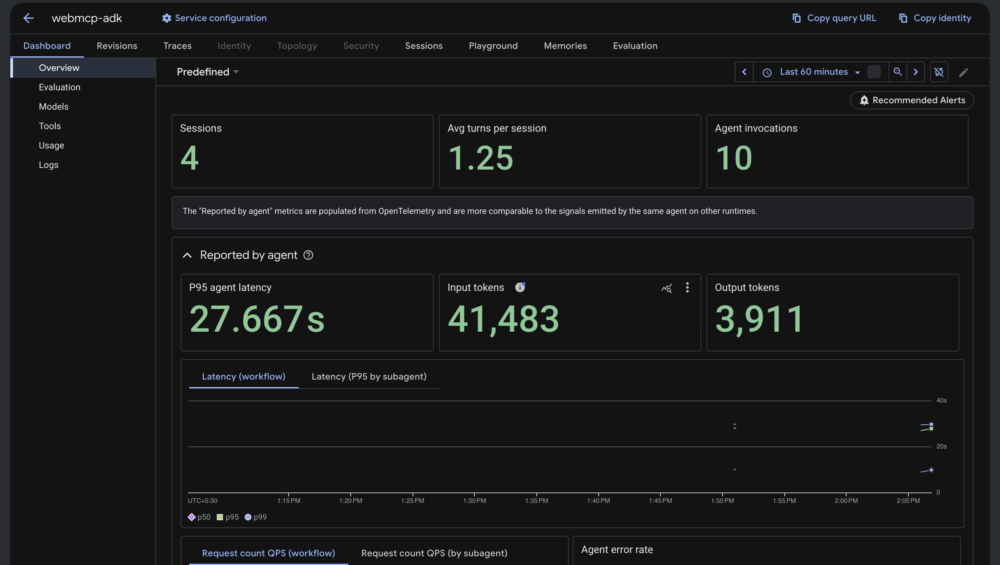
*Overview dashboard: 4 sessions, 10 invocations, 27.667s P95 agent latency, 41,483 input tokens, and 3,911 output tokens.*

Switching to **Token usage by input / output (trace-based)** breaks down per-invocation prompt and completion token spikes across individual turns so you can spot context-heavy requests immediately.

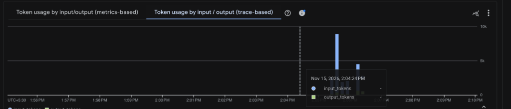
*Trace-based input and output token distribution across individual agent turns.*

Below the agent-reported charts, **Reported by Agent Runtime** tracks container-level HTTP health—`Agent latency` (`p50`/`p95`/`p99`), `Agent request count` (`2xx` vs. `4xx` QPS), and `Agent error rate` (`200` vs. `404`)—separating infrastructure overhead from LLM reasoning time.

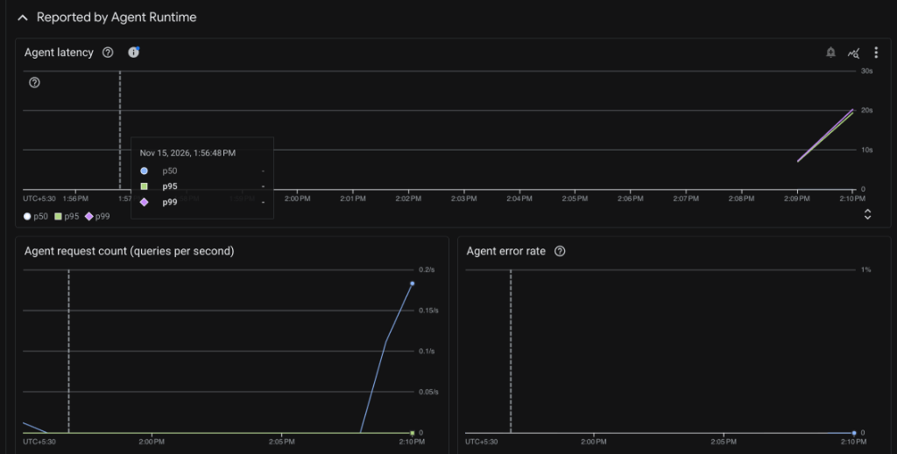
*Container-level HTTP latency percentiles, QPS (`2xx`/`4xx`), and error rate reported by Agent Runtime.*

The **Models** tab isolates LLM inference performance for `gemini-3.8-flash`, showing 13 model calls in the 15-minute window at a 6.912s P95 model latency alongside per-model call counts and inference calls per invocation.

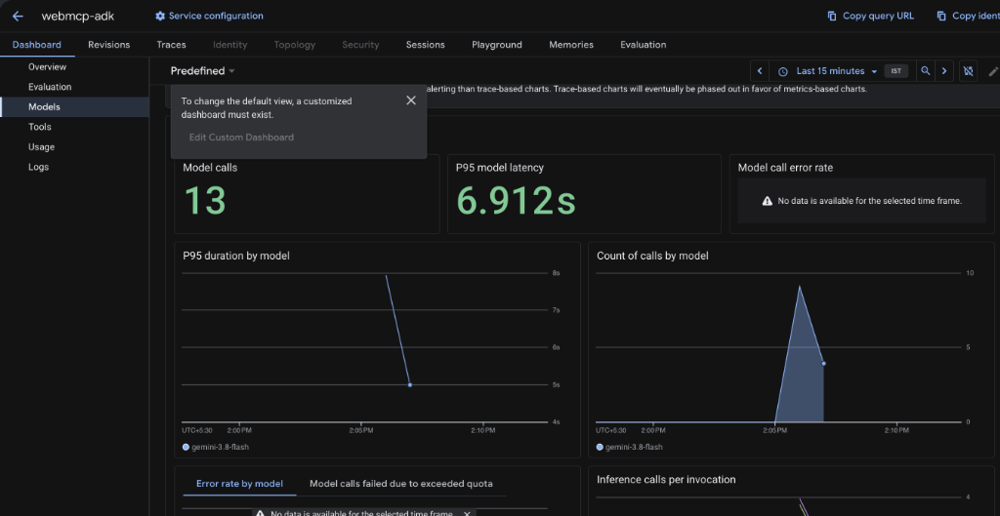
*Model telemetry for `gemini-3.8-flash`: 13 model calls at 6.912s P95 model latency.*

Drilling into **Tools** monitors every WebMCP tool invocation and error rate: 12 tool calls across all 7 tools (`add_to_cart`, `apply_promo_code`, `checkout_order`, `get_cart`, `get_product_details`, `search_products`, and `update_shipping_form`) completing in 0.01s P95 tool latency, with the 8.333% error rate reflecting our deliberate `checkout_order` safety-guardrail test.

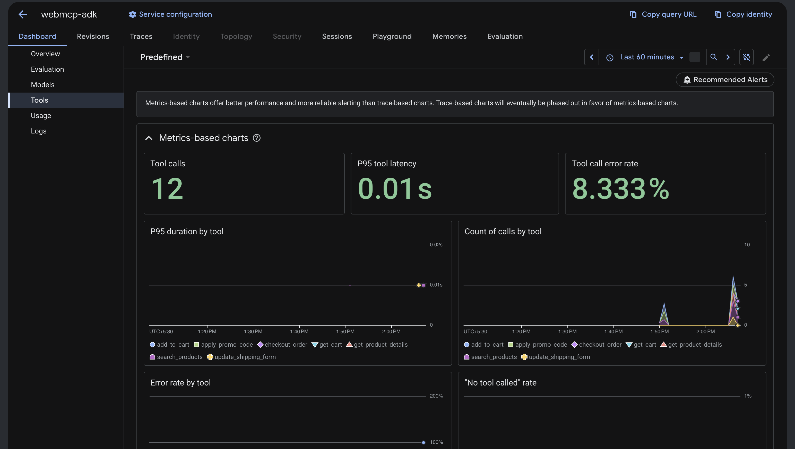
*Tool telemetry: 12 tool calls at 0.01s P95 tool latency across all 7 WebMCP tools.*

The **Usage** tab pairs cumulative token consumption (41,483 input / 3,911 output tokens) with trace-based container CPU allocation (peaking at 0.404s) and memory allocation (peaking at 1.212GiB) for right-sizing runtime limits.

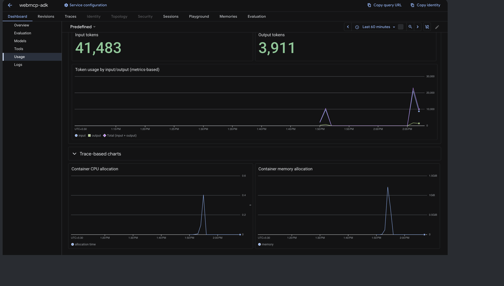
*Token consumption alongside container CPU (`0.404s` peak) and memory (`1.212GiB` peak) allocation.*

Opening **Traces** inspects any individual production request down to the span level. Here, a single `POST /run_sse` request (`19.741s`, 12 spans, 11K input / 442 output tokens) breaks down into `invoke_workflow webmcp_agent`, four `generate_content` calls, and sub-millisecond `search_products`, `add_to_cart`, and `apply_promo_code` executions.

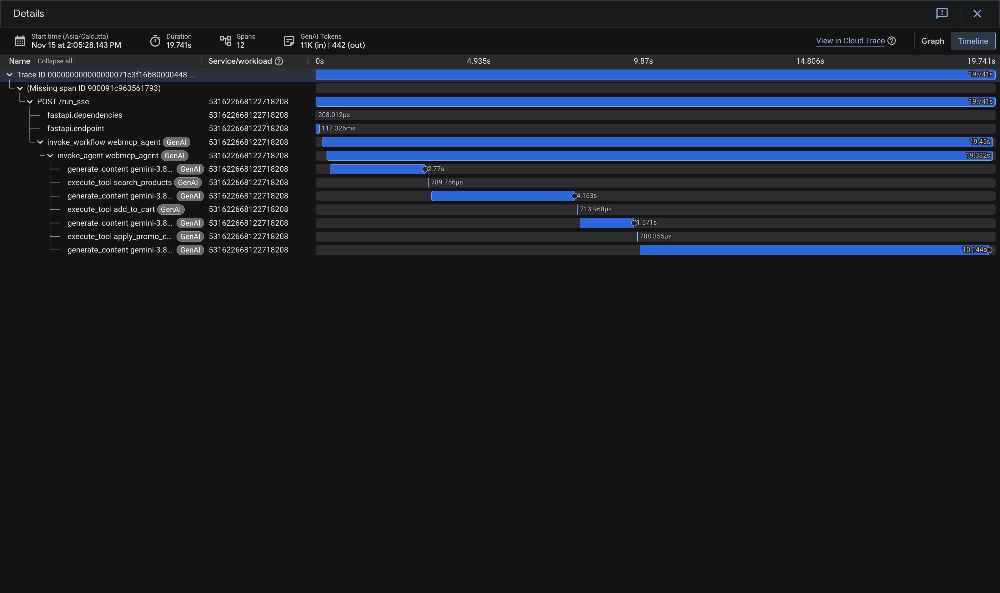
*Production OpenTelemetry trace waterfall (`19.741s`, 12 spans) across `POST /run_sse`, LLM calls, and WebMCP tool executions.*

You can also toggle the trace view to **Graph** to inspect the span execution DAG and see how FastAPI dependencies, `invoke_agent`, LLM generations, and WebMCP tools branch out.

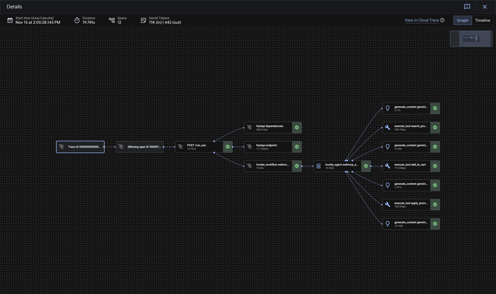
*Span execution DAG for trace `000000000000000071c3f16b80000448` (`19.741s`, 12 spans).*

The **Sessions** tab lists active conversation threads (`demo-user`, `load-user-1`, `load-user-2`, and A2A sessions) with creation and last-active timestamps for auditing multi-turn state.

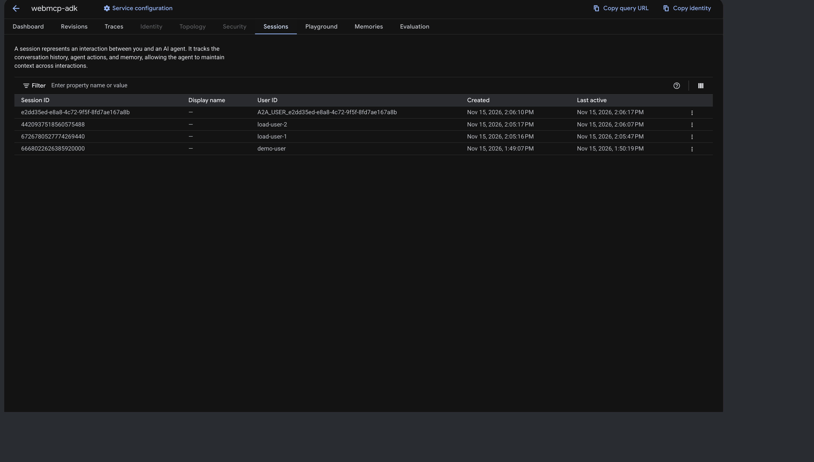
*Sessions table tracking active ADK and A2A conversation threads.*

In **Revisions**, `runtimeRevisions/1` is active and serving 100% of traffic cleanly with `Always latest` traffic splitting.

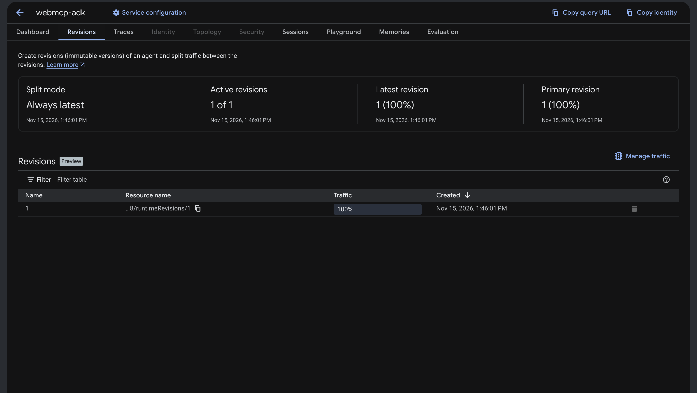
*Revision management: `1 of 1` active revision (`runtimeRevisions/1`) serving 100% of traffic.*

Finally, **Agent logs** aggregates live HTTP access and trace-correlated entries, confirming `200 OK` responses across `POST /a2a/app`, `POST /run_sse`, `/apps/app/users/.../sessions`, `/a2a/app/.well-known/agent-card.json`, and `/api/webmcp/status`.

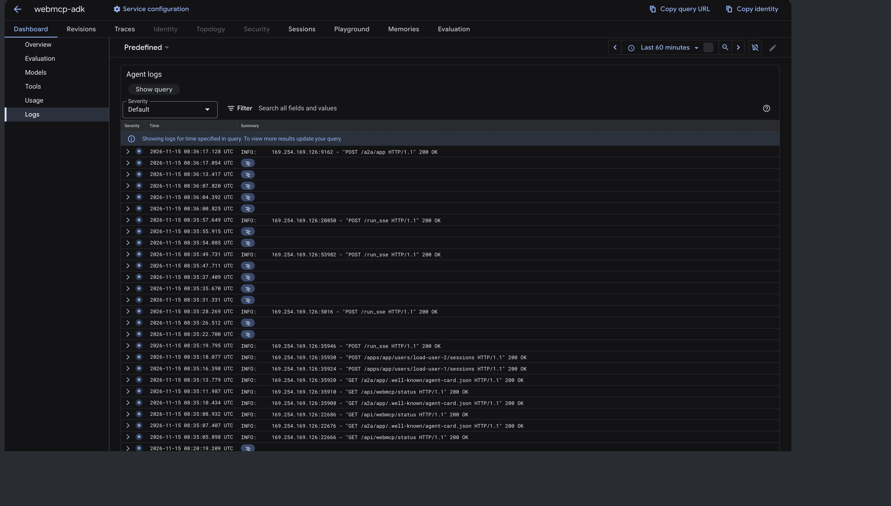
*Agent logs showing `200 OK` HTTP responses across `/a2a/app`, `/run_sse`, session creation, agent-card discovery, and `/api/webmcp/status`.*

---

## Try It Yourself

WebMCP replaces brittle DOM scraping with an explicit contract between your web app and the AI agent. Pairing `navigator.modelContext` and `<form toolname>` with Google ADK gives you Python-enforced guardrails, OpenTelemetry observability, and repeatable evals out of the box.

Clone the repository and run it locally in Chrome:

```bash
git clone https://github.com/sanketbisne/adk-webmcp-storefront.git
cd adk-webmcp-storefront
agents-cli install
uv run uvicorn app.fast_api_app:app --host 127.0.0.1 --port 8000 --reload
```

Open `http://127.0.0.1:8000/webmcp` and watch the WebMCP Inspector as you shop with the agent.
